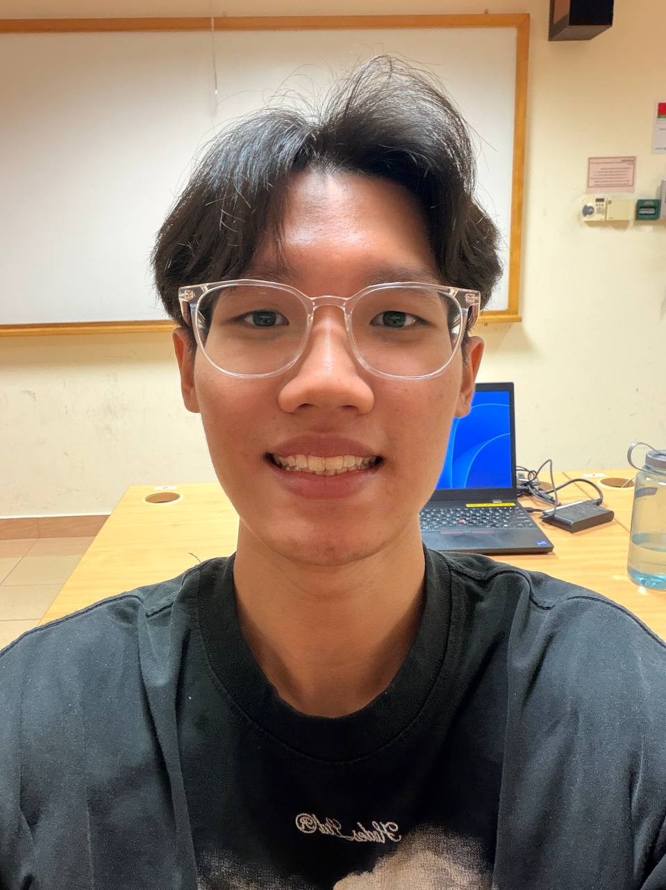

# About Us

We develop TeachAssist, a desktop application that helps teaching assistants manage student records, tutorial-group labels, remarks, and attendance.

We are a team based in the [School of Computing, National University of Singapore](https://www.comp.nus.edu.sg).

For TeachAssist questions and bug reports, use the [project issue tracker](https://github.com/AY2627S1-CS2103T-F12-1/tp/issues).

## Project team

### Samuel Lau

[[github](https://github.com/sammeowwww)]
[[portfolio](team/sammeowwww.md)]

* Role: Project Advisor
* Responsibilities: Student add/delete commands and command documentation

### Ananya Kharbanda

[[github](https://github.com/ananyakharbanda)]
[[portfolio](team/ananyakharbanda.md)]

* Role: Developer
* Responsibilities: Student listing and remark editing, UI and application reliability improvements, testing, and project documentation

### Bryan Lee Jun You

[[github](https://github.com/8ryanl33)] [[portfolio](team/8ryanl33.md)]

* Role: Developer
* Responsibilities: Data

### Gou Guan Lin

[[github](https://github.com/amberrrruby)]
[[portfolio](team/amberrrruby.md)]

* Role: Developer
* Responsibilities: Group labels and filtering

### Tristan Tay

[[github](https://github.com/DaRealTristan)]
[[portfolio](team/darealtristan.md)]

* Role: Developer
* Responsibilities: Student find/unmark commands and documentation
