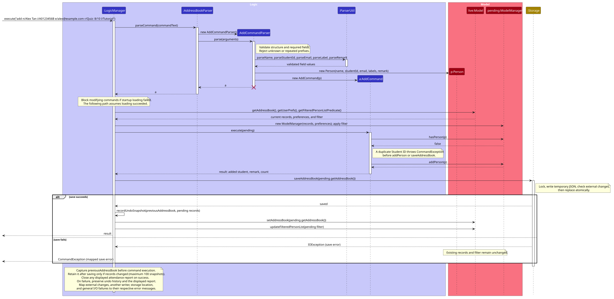
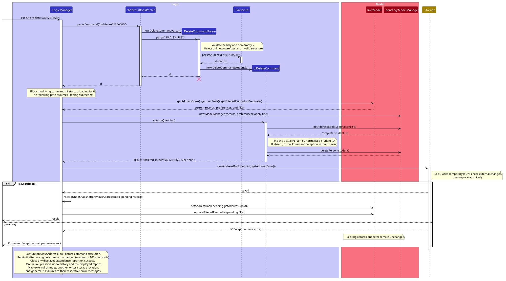

# TeachAssist Developer Guide

<!-- * Table of Contents -->
<page-nav-print />

--------------------------------------------------------------------------------------------------------------------

## **Acknowledgements**

* TeachAssist's initial codebase, architecture and documentation structure are adapted from [AddressBook Level 3](https://github.com/se-edu/addressbook-level3), created by the [SE-EDU initiative](https://se-education.org).
* Application libraries: [JavaFX](https://openjfx.io/) for the graphical interface and [Jackson](https://github.com/FasterXML/jackson) for JSON persistence.
* Testing and build tools: [JUnit 5](https://junit.org/junit5/), [Gradle](https://gradle.org/), [Shadow](https://gradleup.com/shadow/), [Checkstyle](https://checkstyle.org/) and [JaCoCo](https://www.jacoco.org/jacoco/).
* Documentation tools: [MarkBind](https://markbind.org/) for the website and [PlantUML](https://plantuml.com/) for UML diagrams.

--------------------------------------------------------------------------------------------------------------------

## **Setting up, getting started**

Refer to the guide [_Setting up and getting started_](SettingUp.md).

--------------------------------------------------------------------------------------------------------------------

## **Design**

### Architecture

<puml src="diagrams/ArchitectureDiagram.puml" width="280" />

The ***Architecture Diagram*** given above explains the high-level design of the App.

The following provides a quick overview of the main components and their interactions.

**Main components of the architecture**

**`Main`** (consisting of classes [`Main`](https://github.com/AY2627S1-CS2103T-F12-1/tp/blob/master/src/main/java/seedu/address/Main.java) and [`MainApp`](https://github.com/AY2627S1-CS2103T-F12-1/tp/blob/master/src/main/java/seedu/address/MainApp.java)) is in charge of the app launch and shut down.
* At app launch, it initializes the other components in the correct sequence, and connects them up with each other.
* At shut down, it shuts down the other components and invokes cleanup methods where necessary.

The bulk of the app's work is done by the following four components:

* [**`UI`**](#ui-component): The UI of the App.
* [**`Logic`**](#logic-component): The command executor.
* [**`Model`**](#model-component): Holds the data of the App in memory.
* [**`Storage`**](#storage-component): Reads data from, and writes data to, the hard disk.

[**`Commons`**](#common-classes) represents a collection of classes used by multiple other components.

**How the architecture components interact with each other**

The *Sequence Diagram* below shows the components interacting for `delete i/A0123456B`.

<puml src="diagrams/ArchitectureSequenceDiagram.puml" width="574" />

Each of the four main components (also shown in the diagram above),

* defines its *API* in an `interface` with the same name as the Component.
* provides its functionality through a concrete `{Component Name}Manager` class that implements the corresponding API interface.

For example, the `Logic` component defines its API in `Logic.java` and implements it in `LogicManager.java`. Other components interact with a component through its interface rather than its concrete class, preventing them from coupling to that component's implementation, as illustrated in the following partial class diagram.

<puml src="diagrams/ComponentManagers.puml" width="300" />

The sections below give more details of each component.

### UI component

The **API** of this component is specified in [`Ui.java`](https://github.com/AY2627S1-CS2103T-F12-1/tp/blob/master/src/main/java/seedu/address/ui/Ui.java)

<puml src="diagrams/UiClassDiagram.puml" alt="Structure of the UI Component"/>

The UI consists of a `MainWindow` and its parts, such as `CommandBox`, `ResultDisplay`, `PersonListPanel`, `AttendanceListPanel`, and `StatusBarFooter`. All of these, including `MainWindow`, inherit from the abstract `UiPart` class, which captures common behavior among classes that represent visible GUI parts.

The `UI` component uses the JavaFX UI framework. The layouts of these UI parts are defined in matching `.fxml` files in `src/main/resources/view`. For example, [`MainWindow.fxml`](https://github.com/AY2627S1-CS2103T-F12-1/tp/blob/master/src/main/resources/view/MainWindow.fxml) specifies the layout of [`MainWindow`](https://github.com/AY2627S1-CS2103T-F12-1/tp/blob/master/src/main/java/seedu/address/ui/MainWindow.java).

The `UI` component,

* executes user commands using the `Logic` component.
* listens for changes to `Model` data so that the UI can be updated with the modified data.
* keeps a reference to the `Logic` component, because the `UI` relies on the `Logic` to execute commands.
* depends on some classes in the `Model` component because it displays `Person` objects and `AttendanceReport` objects from the model.
* shows an `AttendanceListPanel` in place of the `PersonListPanel` while a command result carries an attendance report. See [Viewing attendance](#viewing-attendance).

### Logic component

**API** : [`Logic.java`](https://github.com/AY2627S1-CS2103T-F12-1/tp/blob/master/src/main/java/seedu/address/logic/Logic.java)

Here's a (partial) class diagram of the `Logic` component:

<puml src="diagrams/LogicClassDiagram.puml" width="550"/>

The [add](#adding-student-information) and [delete](#deleting-student-information) sequence diagrams below
show how parsed commands change a temporary model before the live model is updated.


How the `Logic` component works:

1. When `Logic` is called upon to execute a command, the command is passed to an `AddressBookParser` object, which in turn creates a parser that matches the command (e.g., `DeleteCommandParser`) and uses it to parse the command.
1. This results in a `Command` object (more precisely, an object of one of its subclasses e.g., `DeleteCommand`) which is executed by the `LogicManager`.
1. The command can communicate with the `Model` when it is executed (e.g. to delete a student).<br>
   Note that although this is shown as a single step in the diagram above for simplicity, the code can require several interactions between the command object and the `Model` to complete the operation.
1. The result of the command execution is encapsulated as a `CommandResult` object which is returned from `Logic`.

Here are the other classes in `Logic` (omitted from the class diagram above) that are used for parsing a user command:

<puml src="diagrams/ParserClasses.puml" width="600"/>

How the parsing works:
* When called upon to parse a user command, the `AddressBookParser` class creates an `XYZCommandParser` (`XYZ` is a placeholder for the specific command name, e.g., `AddCommandParser`). The parser uses the other classes shown above to parse the user command and create an `XYZCommand` object (e.g., `AddCommand`). The `AddressBookParser` returns that object as a `Command` object.
* All `XYZCommandParser` classes, such as `AddCommandParser` and `DeleteCommandParser`, implement the `Parser` interface so they can be treated similarly where appropriate, for example during testing.

### Model component
**API** : [`Model.java`](https://github.com/AY2627S1-CS2103T-F12-1/tp/blob/master/src/main/java/seedu/address/model/Model.java)

<puml src="diagrams/ModelClassDiagram.puml" width="450" />


The `Model` component,

* stores the student data i.e., all `Person` objects (which are contained in a `UniquePersonList` object).
* uses `studentId` as the domain identifier for `Person` duplicate checks. The JavaFX `id` label in `PersonListCard.fxml` is only the displayed list index, not the student's identifier.
* stores group labels as `Label` objects inside each `Person`.
* stores attendance as `AttendanceRecord` objects (a date and a group) inside each `Person`, and builds `AttendanceReport` objects from the student list on request.
  Each report contains `AttendanceEntry` values pairing a student with their presence status. Reports are derived
  by the logic layer using `AttendanceReport#of`; they are not saved in the address book.
* stores the `Person` objects selected by the current filter, such as search results, in a separate _filtered_ list. It exposes this list as an unmodifiable `ObservableList<Person>` that the UI can observe and bind to, so the UI updates when the list changes.
* stores a `UserPrefs` object that represents the user's preferences (currently, just the GUI settings). This is exposed to the outside as a `ReadOnlyUserPrefs` object.
* does not depend on any of the other three components (as the `Model` represents data entities of the domain, they should make sense on their own without depending on other components)


<box type="info" seamless>

**Note:** The alternative, arguably more object-oriented, design below keeps a unique list of labels in `AddressBook`, and each `Person` references values from that list. This lets `AddressBook` maintain one value object per unique label instead of each `Person` holding its own objects.<br>

<puml src="diagrams/BetterModelClassDiagram.puml" width="450" />
</box>


### Storage component

**API** : [`Storage.java`](https://github.com/AY2627S1-CS2103T-F12-1/tp/blob/master/src/main/java/seedu/address/storage/Storage.java)

<puml src="diagrams/StorageClassDiagram.puml" width="550" />

The `Storage` component,
* can save both student data and user preference data in JSON format, and read them back into corresponding objects.
* expects each stored `Person` JSON object to contain a valid `studentId`. There is currently no migration or default-value strategy for old data files missing this field.
* stores group labels through `JsonAdaptedLabel`. Missing or null `labels` fields are treated as empty label sets for compatibility with older data files.
* ignores legacy `tags` fields when loading older data files and omits them when saving.
* reports loading failures as `DataLoadingException`, distinguishing unreadable files, invalid data, and duplicate Student IDs. See [Loading student data at startup](#loading-student-data-at-startup).
* writes student data atomically and reports a data folder that cannot be created as `DataStorageLocationException`. See [Saving before publishing changes](#saving-before-publishing-changes).
* is implemented by `StorageManager`, which delegates the actual JSON file access to `JsonAddressBookStorage` and `JsonUserPrefsStorage` (one class per data file).
* depends on some classes in the `Model` component (because the `Storage` component's job is to save/retrieve objects that belong to the `Model`)

### Common classes

Classes used by multiple components are in the `seedu.address.commons` package.

--------------------------------------------------------------------------------------------------------------------

## **Implementation**

This section describes some noteworthy details on how certain features are implemented.

### Group labels

An optional group label is assigned when creating a student with `add ... l/LABEL_NAME`.
`Label` validates the value, and `ParserUtil#parseLabel` trims command input before constructing it.
`JsonAdaptedLabel` and `JsonAdaptedPerson` persist labels under each student's `labels` JSON field.
`EditCommand` preserves labels unless label changes are requested, and `PersonCard` renders them in its `FlowPane`.
Existing saved labels remain compatible, including records containing multiple labels.

### Edit command

Format: `edit i/STUDENT_ID [n/NAME] [e/EMAIL] [r/REMARK] [l/LABEL_NAME]... [dl/LABEL_NAME]...`

`EditCommandParser` checks command structure and parses the Student ID and requested field changes.
It collects repeated `l/` and `dl/` values into the `EditPersonDescriptor`. An empty `l/` requests
clearing all labels and is rejected if combined with another label change. An empty `r/` becomes
an empty remark.

`EditCommand` finds the student by Student ID in the complete student list, so a filtered view
does not change the target. It builds a replacement `Person`, keeping fields that were not supplied.
For labels, it copies the student's set, removes each `dl/` label, then adds each `l/` label.
Matching is case-insensitive. Removing a missing label or adding one already present throws a
`CommandException`, leaving the record unchanged. An empty `l/` produces an empty label set.
The command then replaces the student through `Model#setPerson`; `LogicManager` saves the pending
model before publishing it to the live model.

The sequence diagram below shows an edit that removes one label and adds another. It also shows that
a save failure leaves the live student data unchanged.

<puml src="diagrams/EditLabelSequenceDiagram.puml" alt="Editing student labels and saving before publishing" />

### Mark and unmark attendance

Command formats:

```text
mark i/STUDENT_ID d/YYYY-MM-DD l/GROUP
unmark i/STUDENT_ID d/YYYY-MM-DD l/GROUP
```

The accepted inputs, examples, and feedback are documented under
[Recording attendance](UserGuide.md#recording-attendance-mark) and
[Removing attendance](UserGuide.md#removing-attendance-unmark) in the User Guide.

#### Parsing and validation

`AddressBookParser` routes each command to `MarkCommandParser` or `UnmarkCommandParser`.
Both tokenise `i/`, `d/`, and `l/`, accepting any parameter order and exactly one non-empty value for each.
Their structure checks follow the same order: internal line breaks, unknown prefixes, preamble text, repeated
prefixes, then missing or empty values. Repeated and missing/empty checks use `i/`, `d/`, `l/` order.
The general command parser rejects multiline input before command-specific parsing.

Both parsers reuse `ParserUtil#parseStudentId`, `ParserUtil#parseDate`, and `ParserUtil#parseLabel`, in that order.
The date parser requires a valid calendar date in the strict `YYYY-MM-DD` format. The parsers then construct
`MarkCommand` or `UnmarkCommand` with the validated values.

#### Matching and updating records

Both commands search `Model#getAddressBook().getPersonList()` by normalised Student ID, so a student hidden by
the active filter can still be updated. A missing student throws `CommandException` before any change.

* `MarkCommand` first finds a current group label using case-insensitive matching. It creates an
  `AttendanceRecord(date, matchedGroup)` and rejects an existing entry for that date and group.
  Otherwise, it adds the record to a copy of the student's attendance set.
* `UnmarkCommand` searches the existing attendance set using `AttendanceRecord#equals`, which compares dates
  exactly and group names case-insensitively using `Locale.ROOT`. A missing record throws `CommandException`.
  Otherwise, it removes the matched record from a copy of the set. Current group membership is not required:
  `EditCommand` retains attendance when labels change, and historical records must remain removable.
  Success feedback uses the matched record's stored group spelling.

Each command constructs a replacement `Person`, retaining every other field, and calls `Model#setPerson`.
Other attendance entries and the active filter remain unchanged. `unmark` removes the specified attendance entry;
like other successful data changes, it can later be reversed by `undo`.

#### Saving and sequence diagrams

Both commands return `true` from `Command#isModifyingData`. `LogicManager` blocks them after a startup loading
failure, executes them on a pending model, saves that model, and only then publishes it to the live model.
Parsing, command, or save failures preserve the live records, filter, and previous saved file.
The existing attendance JSON representation is reused; no storage format change is needed.

The following diagrams show valid commands with an existing student and attendance state appropriate to the
operation, including the save-before-publish path and save-failure protection.

<puml src="diagrams/MarkSequenceDiagram.puml" alt="Parsing, recording, and saving student attendance" />

<puml src="diagrams/UnmarkSequenceDiagram.puml" alt="Parsing, removing, and saving student attendance" />

#### Tests

`MarkCommandTest` and `UnmarkCommandTest` cover record updates and command errors. `UnmarkCommandTest` also
checks that other dates and groups remain, hidden students can be updated, removed group labels do not block
removal, and marking followed by unmarking restores the original student.
The command parser tests cover parameter validation, and `AddressBookParserTest` checks unmark routing.
`LogicManagerTest` covers persistence and reload, failed saves, filter preservation, and startup failure protection.

### Adding student information

Command format: `add n/NAME i/STUDENT_ID e/EMAIL [r/REMARK] [l/LABEL_NAME]`.
One optional group label can be assigned during add; `Label` defines its validation rules.
Accepted values are documented in the [UG field rules](UserGuide.md#field-rules); exact messages and validation order
are in [Appendix: Errors](#appendix-errors).

#### Validation and identity

* `ArgumentTokenizer` recognises supported prefixes at the start of arguments or after whitespace, including tabs.
* `AddCommandParser` checks line breaks, unknown alphabetic prefixes, preamble text, repeated prefixes,
  missing mandatory fields, then empty mandatory fields. Errors are reported before parsing field values.
  Repeated/missing/empty checks follow `n/`, `i/`, `e/` order; repeated `r/` and `l/` are checked after them.
* `ParserUtil` trims values and converts invalid fields into `ParseException`s. Model constructors also validate,
  so records created by storage or other callers follow the same rules.
* `Name` accepts 1–100 Unicode code points after trimming and collapsing repeated spaces, requires a letter,
  and permits Unicode letters/combining marks, spaces, apostrophes, hyphens, and periods. Case is preserved.
* `StudentId` accepts nine ASCII alphanumeric characters and stores uppercase using `Locale.ROOT`.
  `Person#isSamePerson` compares this normalised ID, not the name or email.
* `Email` enforces the supported ASCII format, local-part limit of 64, overall limit of 254, domain-label limits
  of 63, and a final label of 2–63 letters. Only the domain is lowercased using `Locale.ROOT`.
* `Remark` accepts at most 4,000 Unicode code points; command parsing trims only surrounding whitespace.
  Empty or omitted remarks become empty strings. `r/` can appear anywhere and does not consume later parameters.
* `Label` accepts 1–60 Unicode code points and requires at least one letter or digit. It permits letters,
  combining marks, digits, spaces, hyphens, underscores, apostrophes, parentheses, and periods. Empty labels
  are rejected, omitted labels become an empty label set, and `l/` can appear anywhere without consuming later parameters.

For example, `add n/  Alex   Tan i/a0123456b e/Alex@EXAMPLE.COM l/Tutorial 1 r/Quiz: 8/10`
creates a student with name `Alex Tan`, ID `A0123456B`, email `Alex@example.com`, label `Tutorial 1`,
and remark `Quiz: 8/10`.
An alphabetic token such as `x/value` is rejected even inside a remark; `8/10` and URLs remain literal text.
A duplicate ID rejects the complete command without merging any details or remarks.

#### Saving before publishing changes

The execution path is:

```text
AddressBookParser → AddCommandParser → AddCommand
LogicManager → temporary ModelManager → JsonAddressBookStorage → live ModelManager
```

1. `Command#isModifyingData` identifies commands that alter student records. `add`, `edit`, `delete`, `mark`, `unmark`, `clear`,
   and `undo` return true. Future modifying commands must override this method too. `undo` uses the separate snapshot
   transaction described in [Undoing data changes](#undoing-data-changes).
2. `LogicManager` copies the live records and current filter into a temporary `ModelManager`, then executes the command
   against that copy. Copying the filter preserves the active view if saving fails; `edit` identifies its target by
   Student ID from the full record list rather than by displayed index.
3. `JsonAddressBookStorage` writes the proposed records to a temporary file in the destination directory.
   `Files.move` with `ATOMIC_MOVE` and `REPLACE_EXISTING` replaces the old file only after writing completes.
   There is no fallback overwrite when atomic replacement is unsupported. Temporary files are removed after failure.
4. After saving succeeds, `LogicManager` publishes the proposed records and filter to the live model, then returns
   the success feedback. If saving fails, it returns `Unable to save student data.`; live records and the active filter
   are unchanged, and the previous data file remains intact.

The sequence diagram shows an add with an optional remark and label. It also shows that a failed save leaves the
live model unchanged. Invalid parameters or a duplicate Student ID stop execution before saving.



[PlantUML source](diagrams/AddSequenceDiagram.puml)

For example, adding a student while viewing a filtered list restores the complete list only after saving succeeds.
If replacement fails, the filtered list remains as it was and the new student is not added.
Read-only commands such as `find`, `list`, `help`, and `exit` execute on the live model without saving student data.

#### Startup and feedback

`MainApp` starts empty when the data file is missing. If loading fails, it creates an empty model and configures
`LogicManager` to block modifying commands, `list`, `find`, and `attendance` until the file is fixed and the application
is restarted.
The error is `Student data is unavailable because loading failed. Fix the data file and restart.`
This prevents an empty model from overwriting unreadable or invalid records. `help` and `exit` remain available.

Successful adds display `Added student ID: NAME.`, followed by ` Remark: TEXT` when the remark is non-empty,
and the total student count on the next line. The count uses the complete record list.
`PersonCard` displays labels and non-empty remarks with wrapping, and hides the remark field for
empty remarks.
JSON storage preserves remarks and defaults missing/null remark fields to empty strings.

#### Verification

Tests cover field boundaries and normalisation, label parsing, parameter errors and ordering, duplicate IDs with changed details,
feedback with/without remarks, JSON round trips, filtered-list handling, startup loading failures, and save failures.
Replacement-failure tests simulate an error after the temporary file is written and check that the original file,
records, and active filter remain unchanged. They also check temporary-file cleanup and failed first saves.

### Find command

Command format: `find n/KEYWORD [MORE_KEYWORDS]...`, `find i/KEYWORD [MORE_KEYWORDS]...`,
`find e/KEYWORD [MORE_KEYWORDS]...`, `find r/KEYWORD [MORE_KEYWORDS]...`, or `find l/LABEL_NAME`.
Supply exactly one search field. Label searches replace the former standalone filter command.
See the [User Guide](UserGuide.md#finding-students-by-name-student-id-email-remark-or-label-find) for examples and
[Find errors](#find-errors) for error messages and validation order.

#### Validation and matching

* `ArgumentTokenizer` recognises `n/`, `i/`, `e/`, `r/`, and `l/`.
* `FindCommandParser` checks words before the first prefix, unknown prefixes, repeated prefixes, missing prefixes,
  multiple search-field types, empty values, and then label validity, in that order.
* Name, ID, email, and remark values are split into whitespace-separated keywords. `NameContainsKeywordsPredicate`,
  `StudentIdContainsKeywordsPredicate`, `EmailContainsKeywordsPredicate`, and `RemarkContainsKeywordsPredicate`
  match any keyword using
  `StringUtil#containsIgnoreCase`, including partial matches.
* `RemarkContainsKeywordsPredicate` searches `Person#getRemark().value` only. Empty remarks do not match
  non-empty keywords. Numeric slash text such as `8/10` is accepted under the existing prefix rules.
* A label value is kept whole, validated by `ParserUtil#parseLabel`, and passed to `LabelMatchesPredicate`.
  This predicate lowercases both the requested and stored label names with `Locale.ROOT`, then compares the complete
  values, using the same rule as `EditCommand` and `JsonAdaptedPerson`. Internal spaces are preserved.
  This also handles Unicode lowercase expansions, such as `İ` becoming `i` followed by a combining dot,
  while keeping `I` and the dotless `ı` distinct.

For example, `find n/alex david` finds names containing either keyword, while `find l/Discrete Math Tutorial`
finds students with that complete group label. `find l/Tutorial` does not match `Discrete Math Tutorial`.
`find r/recursion loops` searches remarks for either keyword, and `find r/curs` also matches `recursion`.
Empty `r/`, repeated `r/`, and combinations such as `find r/recursion l/Tutorial 1` are rejected before execution.

#### Execution, persistence, and startup behaviour

```text
AddressBookParser → FindCommandParser → FindCommand
FindCommand → Model#updateFilteredPersonList
```

Every search replaces the active predicate and evaluates the complete student list; searches do not narrow the
previous result set. `FindCommand` returns the standard `N students listed.` (or `1 student listed.` for one match) feedback. Zero matches clear the view.
`list` restores all students. Invalid commands preserve the previous view.

`FindCommand` remains read-only. `LogicManager` executes it without saving, including when startup data loading
failed. Student records and the saved JSON file remain unchanged.

Tests in `RemarkContainsKeywordsPredicateTest`, `FindCommandParserTest`, and `FindCommandTest` cover remark
matching, invalid remark search inputs, result counts, and searching students hidden by a previous filter.

The name-search sequence is shown below; remark and label searches use their corresponding predicates.

<puml src="diagrams/FindCommandSequenceDiagram.puml" alt="Interactions for a name search" />

The following diagrams show label searching through the integrated command:

<puml src="diagrams/LabelFindSequenceDiagram.puml" alt="Interactions for finding students by label" />

<puml src="diagrams/LabelFindActivityDiagram.puml" alt="Validation and results for a label search" />

#### Verification

Tests cover all five prefixes, malformed and repeated parameters, mixed search fields, multi-word and boundary-length
labels, invalid labels, exact and case-insensitive matching, multiple student labels, empty and zero-result lists,
searches after other searches, restoration with `list`, saved-data preservation, and rejection of the removed command.

### Deleting student information

Command format: `delete i/STUDENT_ID`. The display index is not used to identify students for deletion.

`DeleteCommandParser` accepts exactly one non-empty `i/`. It rejects line breaks, unknown prefixes, preamble text,
repeated IDs, missing IDs, and empty IDs before calling `ParserUtil#parseStudentId`.
`ArgumentTokenizer#findUnknownPrefix` shares the same case-sensitive alphabetic-prefix detection with `add`.
An invalid Student ID retains the field constraint message instead of being replaced with a usage error.

`DeleteCommand` stores the validated `StudentId` and searches `model.getAddressBook().getPersonList()` for an exact
normalised ID match. It retrieves the existing `Person` and passes that object to `model.deletePerson`.
This removes the entire record, including remarks and labels, without separately deleting its fields.
The complete record list is searched so a student hidden by a filter can still be deleted.

For example, after `find n/Benson`, `delete i/a1234567b` removes Alice's `A1234567B` record while the displayed Benson
results remain unchanged. If Alice is already absent, the command reports
`Student with ID A1234567B is not in the records.` and changes no data.
Successful feedback is `Deleted student A1234567B: Alice Pauline.`

Deletion preserves the current filter and returns true from `Command#isModifyingData`.
`LogicManager` therefore performs it on the temporary model, saves the proposed records, and only then publishes
the change. If saving fails, the live record, filter, and previous saved file remain unchanged.
If startup loading failed, deletion is blocked by the existing loading guard.

The sequence diagram shows deletion by Student ID, including the save-failure path.



[PlantUML source](diagrams/DeleteSequenceDiagram.puml)

<box type="info" seamless>

**Note:** The lifeline for `DeleteCommandParser` should end at the destroy marker (X), but due to a limitation of PlantUML, the lifeline continues till the end of the diagram.
</box>

Tests cover normalised IDs, visible/hidden students, an empty displayed list, nonexistent IDs, malformed parameters,
whole-record removal from persisted JSON, filter preservation, and save failures.

### Viewing attendance

The command `attendance d/YYYY-MM-DD l/GROUP` shows which current members of a tutorial group were marked present on
a date. Its accepted values and messages are documented in the
[User Guide](UserGuide.md#viewing-attendance-attendance). Recording and removing attendance are described in
[Mark and unmark attendance](#mark-and-unmark-attendance).

#### Storing attendance

Each `Person` holds an immutable set of `AttendanceRecord` objects. A record is a date and a group `Label`. Two records
are equal when their dates match and their group names match after `toLowerCase(Locale.ROOT)`, the same rule used to
reject duplicate labels. This makes the date and group pair unique for each student.

`JsonAdaptedPerson` saves the records under each person's `attendance` field, and `JsonAdaptedAttendanceRecord`
validates each date and group when loading. A missing or `null` `attendance` field loads as an empty set, so data files
written before attendance existed still load. Records are stored inside the `Person`, so deleting a student deletes
their records, and `edit` keeps them.

Only presence is stored. A student is absent when they have no record for the date and group.

`AttendanceCommandParser` checks `d/` and `l/` in the same order as the `mark` and `unmark` parsers, then reuses
`ParserUtil#parseDate` and `ParserUtil#parseLabel`.

#### Reporting attendance

`AttendanceReport#of(students, date, group)` keeps the students whose current labels include the group, in the order
given, and pairs each one with whether they have the matching record. It also gives the present and absent totals.
Membership comes from current labels, so a student who lost the label is left out even if their records remain.

`AttendanceCommand` is read-only. It builds a report from `model.getAddressBook().getPersonList()`, not the filtered
list, so `find` does not hide group members. It returns `CommandResult#showingAttendance(message, report)`.

#### Showing and refreshing the attendance view

`CommandResult` carries an optional `AttendanceReport`. `MainWindow#executeCommand` shows an `AttendanceListPanel` in
the student list area when a result carries a report, and shows the `PersonListPanel` again when it does not. Each
`AttendanceCard` shows a member's name, Student ID, and a **Present** or **Absent** badge.

`LogicManager` remembers the report being displayed in `displayedAttendance`. After each successful command it:

* stores the result's report if there is one;
* otherwise, if the result reports an attendance update and a report is displayed, rebuilds that report from the live
  model and attaches it to the result with `CommandResult#withAttendanceReport`. `MarkCommand` and `UnmarkCommand`
  report updates by returning `CommandResult#updatingAttendance(message)`;
* otherwise, clears `displayedAttendance`, so the UI returns to the student list.

Because the rebuild happens after saving and publishing, the view only changes once the change is saved. A failed
command throws before this step, so the view stays as it was. A successful `undo` returns a plain result, so it closes
the view; the restored records are shown in the student list.

The sequence diagram below shows `attendance` opening the view, followed by a `mark` that refreshes it. The `alt` block
shows the save-success and save-failure paths.

<puml src="diagrams/AttendanceSequenceDiagram.puml" alt="Showing attendance and refreshing it after mark" />

#### Design considerations

**Aspect: Where to keep the displayed report**

* **Alternative 1 (current choice):** `LogicManager` remembers it and attaches a refreshed report to the result.
  * Pros: `MainWindow` stays a simple renderer, and the refresh rules are tested without JavaFX.
  * Cons: `LogicManager` holds a small piece of display state.
* **Alternative 2:** `MainWindow` remembers the open date and group and asks `Logic` for a new report after `mark`.
  * Pros: Display state stays in the UI.
  * Cons: The UI must know which commands change attendance, and the refresh can only be tested through the GUI.

**Aspect: How to record absence**

* **Alternative 1 (current choice):** Store only presence; absent means not marked.
  * Pros: One command per present student, and no need to finalise a session.
  * Cons: An absence cannot be distinguished from a session the TA has not taken yet.
* **Alternative 2:** Store explicit Present and Absent records.
  * Pros: Every student has a recorded status for every session.
  * Cons: Needs a way to record or finalise absences, and more data to keep consistent when labels change.

#### Verification

* `AttendanceRecordTest` covers equality ignoring group case. `JsonAdaptedPersonTest` covers legacy files without
  `attendance`, invalid saved dates and groups, and duplicate records. `EditCommandTest` checks that edits keep records.
* `AttendanceCommandParserTest` covers invalid dates, and missing, empty, repeated, and unknown parameters.
* `AttendanceCommandTest` covers group members hidden by `find` and groups with no members.
* `AttendanceReportTest` covers several groups on one date, nobody marked, and students who no longer have the label.
* `LogicManagerTest` covers the view refreshing straight after `mark` and `unmark`, a failed mark leaving the view
  open, `undo` and other commands closing it, and marking, restarting, and viewing the saved attendance.
* `MainAppTest` loads a data file without `attendance`, marks students, restarts through the normal startup path,
  and checks the saved attendance and duplicate-mark check.
* `AttendanceListPanelTest` lays out the panel and checks its title, totals, members, and Present and Absent badges.
  JavaFX tests share a confirmed toolkit startup and fail explicitly if startup fails or times out. The Linux CI job,
  which uploads coverage, runs under `xvfb-run` so that JavaFX tests have a virtual display.

### Loading student data at startup

Commands available after a failed load are documented in the [User Guide](UserGuide.md#loading-the-data).
Exact startup messages and data-file rules are in [Loading errors](#loading-errors).

#### Loading and error reporting

The loading path is:

```text
MainApp#initModelManager → StorageManager → JsonAddressBookStorage → JsonSerializableAddressBook
MainApp#initLogic → LogicManager
```

1. `JsonAddressBookStorage#readAddressBook` returns `Optional.empty()` if the data file does not exist.
2. If the file exists, `JsonUtil#readJsonFile` reads it. Failures are reported as `DataLoadingException` with one of
   two messages, chosen by the cause:
   * an `IOException` other than a JSON error, such as missing read permission, gives `Unable to load student data.`
   * a `JsonProcessingException`, such as malformed JSON, gives
     `Unable to load student data. The data file may be corrupted or invalid.`
3. `JsonSerializableAddressBook#toModelType` converts records in file order. A missing or invalid field throws
   `IllegalValueException`, which is reported with the corrupted or invalid message. A repeated Student ID throws
   `DuplicateStudentIdException`, a subclass of `IllegalValueException`. `JsonAddressBookStorage` catches it first so
   that its specific message, `Unable to load student data: duplicate Student ID A0123456B detected.`, is kept.
   Student IDs are compared after normalisation to uppercase.
4. `MainApp` records the outcome as the startup message: `N students loaded.` (`1 student loaded.` for one record),
   the no-existing-data message, or the `DataLoadingException` message.
5. `MainWindow#fillInnerParts` shows `Logic#getStartupMessage` in the result display when the window opens.

The sequence diagram below shows the loading path. The `alt` block shows the three outcomes of reading the data file:
a successful load, a missing file, and a `DataLoadingException`. Model and logic creation continue the same way after
each outcome.

<puml src="diagrams/LoadSequenceDiagram.puml" alt="Loading student data at startup" />

#### Blocking student-data commands after a failed load

When loading fails, `MainApp` starts with an empty `AddressBook` and passes `isStudentDataAvailable = false` to
`LogicManager`. `LogicManager#execute` parses each command first, so malformed commands still receive their usual
error messages. It then rejects modifying commands (including `undo`), `list`, `find`, and `attendance` with
`Student data is unavailable because loading failed. Fix the data file and restart.`

This prevents the empty in-memory list from being saved over the user's data file, which may still be recoverable.
`list`, `find`, and `attendance` are blocked because the empty fallback model is not a successfully loaded dataset.
`help` and `exit` remain available. A missing file or a successfully loaded empty file still permits student-data
commands and genuine zero-total attendance reports. After fixing the file, restart to retry loading.

Saving is described in [Saving before publishing changes](#saving-before-publishing-changes).

#### Design considerations

**Aspect: What to do when the data file cannot be loaded**

* **Alternative 1 (current choice):** Start with an empty list, keep the file, and block commands that change or query student data.
  * Pros: The user's data file is never overwritten, and the user sees why loading failed.
  * Cons: The app cannot be used to change records until the file is fixed.
* **Alternative 2:** Start with an empty list and allow modifying commands, as in AddressBook-Level3.
  * Pros: The app remains fully usable.
  * Cons: The first save overwrites the original file, losing data that might have been fixable.

#### Verification

`MainAppTest` covers a missing file, files with zero, one, and several students, a corrupted file, and duplicate Student
IDs. It checks that modifying commands and student-data queries are blocked and the file is unchanged after a failed
load. Missing files and successfully loaded empty files remain usable.
`JsonAddressBookStorageTest` covers unreadable files, invalid JSON, invalid values, and duplicate Student IDs.

### Undoing data changes

`LogicManager` owns an in-memory deque of complete `AddressBook` snapshots. It retains at most 100 prior states.
The snapshots contain student data only; GUI settings and the current `find` predicate are not recorded.
History begins empty on every application start and is never written to JSON.

Before a normal data-changing command runs, `LogicManager` copies the live address book. It executes the command on
the existing pending model and saves that proposed address book. Only after the save succeeds does it append the
pre-change snapshot, discarding the oldest snapshot first when the deque is full, and publish the pending model.
If the saved address book equals the snapshot, as for `clear` on an empty list, no snapshot is appended, so `undo`
never reports a change it cannot show.
Thus parsing, validation, execution, or save failures leave the live records and undo history unchanged.

For `undo`, `LogicManager` examines the newest snapshot without removing it. It saves that snapshot before replacing
the live address book, resets the displayed list with `Model.PREDICATE_SHOW_ALL_PERSONS`, and then removes the
snapshot. (The displayed list is reset to default, as it could be stale after an undo, for example with a filter applied.
The current design also does not support the notion of saving a "filter", implying "updating the filter" being
out-of-scope, hence the decision to reset the displayed list.) If saving fails, live records, the displayed list,
the saved file, and history remain unchanged. If no snapshot exists, it returns `Nothing to undo.` without saving.

Undo is destructive: restoring a snapshot discards the state being reversed, so there is no redo or forward branch.
A later successful data change records the then-current state as a new predecessor.

<puml src="diagrams/UndoHistoryStateDiagram.puml" alt="Bounded destructive undo history" />

<puml src="diagrams/UndoSequenceDiagram.puml" alt="Undo parsing and transactional restoration" />

#### Design consideration

**Aspect: How undo stores prior state:**

* **Current choice: Complete address-book snapshots in `LogicManager`.**
  * Pros: One transaction handles every data-changing command and keeps saving before publishing explicit.
  * Cons: Each retained state copies the address-book list structure.
* **Alternative: Command-specific inverse operations.**
  * Pros: Can retain less state for some commands.
  * Cons: Every data-changing command must implement and validate its own reverse operation.

--------------------------------------------------------------------------------------------------------------------

## **Documentation, logging, testing, dev-ops**

### Manual testing

Run the application with a fresh data file before starting the cases below. Enter commands in the command box and
check both the feedback area and the student list after each command. The cases use these two sample students:

```text
add n/Alex Tan i/A0123456B e/alex@example.com r/Needs help with recursion l/Tutorial 1
add n/Betsy Lim i/A0234567C e/betsy@example.com l/Tutorial 2
```

#### Help, add, and list

1. Enter `help`. Confirm that the Help window opens, shows the User Guide URL, and that **Copy URL** copies it.
   Enter `help extra` and confirm that the invalid command format message and help usage are shown.
2. Enter the first sample `add` command. Confirm that Alex Tan appears with the supplied ID, email, remark, and
   `Tutorial 1` label. Enter the same command again and confirm that it is rejected as a duplicate Student ID.
3. Enter the second sample `add` command. Confirm that Betsy Lim appears with the supplied ID, email, and
   `Tutorial 2` label. Enter `add n/ i/A0345678D e/valid@example.com` and confirm that the empty name is reported.
4. Enter `list`. Confirm that both students are shown. Enter `list extra` and confirm that the command reports its
   usage without changing the displayed list.

#### Edit and find

1. Enter `edit i/A0123456B e/alextan@example.com l/Consultation`. Confirm that Alex Tan's email changes and that
   both labels are shown. Enter `edit i/A0123456B dl/Consultation l/Tutorial 3` and confirm that `Consultation` is
   removed while `Tutorial 1` and `Tutorial 3` remain.
2. Enter `edit i/A0123456B l/ r/`. Confirm that all of Alex Tan's labels and the remark are cleared. Enter
   `edit i/A0123456B dl/Absent` and confirm that the command is rejected because the label does not exist.
3. Restore Alex Tan's `Tutorial 1` label with `edit i/A0123456B l/Tutorial 1`.
4. Enter `find n/alex`. Confirm that only Alex Tan is displayed and that the result count is one. Enter `find
   l/tutorial 1` and confirm that the same student is found despite the different capitalization.
5. Enter `find r/recursion` and confirm that no students are listed because Alex Tan's remark was cleared. Enter
   `find n/alex i/A0123456B` and confirm that mixed search fields are rejected without changing the current list.
6. Enter `list` to restore the complete list.

#### Mark and unmark attendance

1. Enter `mark i/A0123456B d/2026-10-20 l/tutorial 1`. Confirm the success feedback identifies Alex Tan,
   `Tutorial 1`, and the date. Repeat the command and confirm that duplicate attendance is rejected.
2. Enter `mark i/A0123456B d/2026-02-30 l/Tutorial 1`. Confirm that the invalid date is rejected. Enter
   `mark i/A0123456B d/2026-10-21 l/Tutorial 2` and confirm that a group label Alex Tan does not have is rejected.
3. Enter `unmark i/a0123456b d/2026-10-20 l/tutorial 1`. Confirm the attendance entry is removed, including when
   the Student ID and label capitalization differs. Repeat the command and confirm that it reports the attendance
   is not marked.
4. Enter the first `mark` command again to prepare the later undo case.

#### Viewing attendance

1. Enter `edit i/A0234567C l/Tutorial 1` so that both sample students are current members of `Tutorial 1`. Enter
   `attendance d/2026-10-20 l/tutorial 1`. Confirm that the attendance view replaces the student list, shows Alex
   Tan as **Present** and Betsy Lim as **Absent**, and reports one present and one absent student.
2. Enter `find n/betsy`, then enter `attendance d/2026-10-20 l/Tutorial 1` again. Confirm that the attendance view
   still shows both Tutorial 1 members even though the preceding find result showed only Betsy Lim.
3. While the attendance view is open, enter `mark i/A0234567C d/2026-10-20 l/Tutorial 1`. Confirm that the view
   refreshes immediately and reports two present students. Enter the corresponding `unmark` command and confirm
   that it refreshes to one present and one absent student.
4. Enter `attendance d/2026-10-20 l/No Such Group`. Confirm that an empty attendance view with zero totals is
   shown. Enter `attendance d/2026-02-30 l/Tutorial 1` and confirm that the invalid date is rejected while the
   empty attendance view remains open and unchanged.
5. Enter `list`. Confirm that the student list returns. Enter `attendance d/2026-10-20 i/A0123456B` and confirm
   that the unsupported `i/` parameter is rejected.

#### Delete, clear, and undo

1. Enter `find n/betsy`, then `delete i/A0123456B`. Confirm that Alex Tan is deleted even though the active search
   does not show that student. Enter `list` and confirm that only Betsy Lim remains. Enter `delete i/A0123456B`
   again and confirm that the Student ID is not in the records.
2. Enter the first sample `add` command again, then enter `clear`. Confirm that the student list is empty.
3. Enter `undo`. Confirm that the two students are restored and that the displayed list is reset to show all
   students. Enter `undo` again and confirm that the state before the most recent successful data-changing command
   is restored.
4. Continue entering `undo` until the feedback is `Nothing to undo.`. Confirm that one further `undo` leaves the
   records unchanged. Enter `undo extra` and confirm that the usage message is shown.

#### Exit and persistence

1. Enter the first sample `add` command, then use `list` to confirm that there is at least one student. Enter
   `exit` and confirm that the application closes.
2. Relaunch the application and confirm that the saved student data is loaded. Enter `undo` and confirm that it
   reports `Nothing to undo.`, because undo history is not retained across restarts.

* [Documentation guide](Documentation.md)
* [Testing guide](Testing.md)
* [Logging guide](Logging.md)
* [Configuration guide](Configuration.md)
* [DevOps guide](DevOps.md)

--------------------------------------------------------------------------------------------------------------------

## **Appendix: Requirements**

### Product scope

**Target user profile**:

TeachAssist is for teaching assistants (TAs) who support a fixed group of undergraduate students through weekly tutorials and consultations throughout a semester.
They need to retrieve and update student information quickly while handling teaching, assessment, and follow-up tasks.
They can type quickly and prefer entering text commands over mouse-driven input.

**Value proposition**: Help teaching assistants organise student information and learning progress so they can remember individual students' needs and provide consistent, targeted support throughout the semester.

TeachAssist supports the management of student information, learning progress, interactions, and follow-up needs. It does not aim to replace a learning management system (LMS) for distributing teaching materials, conducting assessments, calculating official grades, or communicating directly with students.

### User stories
Priorities: High (must have) - `* * *`, Medium (nice to have) - `* *`, Low (unlikely to have) - `*`.

High-priority stories cover the agreed MVP, including finding students by name. Medium-priority stories capture other requirements considered by the team; they are not commitments for the MVP or final product. No stories are currently assigned low priority. These are product requirements, not a list of implemented features.

TA refers to a teaching assistant. Story IDs are retained from the project notes, including the gap between US29 and US34.

#### Student information

| ID | Priority | As a/an ... | I want to ... | So that ... |
|----|----------|--------|-------------|----------------|
| US01 | `* * *` | TA | add a student under my care | I can keep information about them throughout the semester |
| US02 | `* * *` | TA | view a student's information | I can quickly recall who the student is |
| US03 | `* * *` | TA | update a student's information | my records remain accurate when circumstances change |
| US04 | `* * *` | TA | remove a student who is no longer under my care | my records remain relevant |
| US05 | `* * *` | TA handling multiple tutorial groups | associate students with their tutorial groups | I can distinguish students from different classes |
| US06 | `* * *` | TA | view students belonging to a particular tutorial group | I can prepare for that group's tutorial |
| US07 | `* *` | TA who remembers only partial information about a student | search for students using information I remember | I can retrieve their records quickly |

#### Student notes and interactions

| ID | Priority | As a/an ... | I want to ... | So that ... |
|----|----------|--------|-------------|----------------|
| US08 | `* * *` | TA | record notes about a student | I can remember important information about them later |
| US09 | `* * *` | TA preparing to meet a student | view my previous notes about the student | I can provide support consistent with our earlier interactions |
| US10 | `* *` | TA | record a consultation with a student | I can remember what we discussed |
| US11 | `* *` | TA | view a student's past interactions chronologically | I can understand how their situation has developed over the semester |
| US12 | `* * *` | TA who made an incorrect note | edit or remove the note | misleading information does not remain in the student's record |
| US13 | `* *` | busy TA | quickly record a short observation about a student during or immediately after class | I do not forget it before recording it later |

#### Learning progress

| ID | Priority | As a/an ... | I want to ... | So that ... |
|----|----------|--------|-------------|----------------|
| US14 | `* *` | TA | record topics that a student is struggling with | I know where the student may need additional support |
| US15 | `* *` | TA | record topics that a student has improved in | I can track their learning progress over time |
| US16 | `* *` | TA preparing for a consultation | view a student's learning progress | I can tailor the consultation to their needs |
| US17 | `* *` | TA preparing a tutorial | see which topics students in my class are commonly struggling with | I can spend more time addressing those areas |
| US18 | `* *` | TA | update a student's progress for a topic | the student's record reflects their current level of understanding |

#### Follow-up tasks with students

| ID | Priority | As a/an ... | I want to ... | So that ... |
|----|----------|--------|-------------|----------------|
| US19 | `* *` | TA | record a follow-up action associated with a student | I do not forget things I need to do for them |
| US20 | `* *` | TA | view my outstanding follow-ups | I know which students still require my attention |
| US21 | `* *` | TA | mark a follow-up as completed | I can distinguish finished tasks from those still requiring action |
| US22 | `* *` | TA handling many students | see which students currently require follow-up | nobody accidentally gets overlooked |
| US23 | `* *` | TA | associate a follow-up with a deadline | I know which matters should be handled first |
| US24 | `* *` | TA | view overdue follow-ups | I can address things I have failed to complete on time |

#### Attendance and participation

| ID | Priority | As a/an ... | I want to ... | So that ... |
|----|----------|--------|-------------|----------------|
| US25 | `* *` | TA | record a student's tutorial attendance | I can keep track of whether they have been attending classes |
| US26 | `* *` | TA | record a student's participation in tutorials | I can remember how actively they have been engaging in class |
| US27 | `* *` | TA | view a student's attendance history | I can notice repeated absences |
| US28 | `* *` | TA | identify students whom I have had little interaction with | I can make an effort to engage them |
| US29 | `* *` | TA preparing for a tutorial | see students who have recently missed tutorials | I am aware that they may need additional support |

#### Finding and organising information

| ID | Priority | As a/an ... | I want to ... | So that ... |
|----|----------|--------|-------------|----------------|
| US34 | `* * *` | TA in a hurry | quickly find a student by name | I can access their information without interrupting my workflow |
| US35 | `* *` | TA with many students | filter students based on information relevant to my current task | I only see the students I need to focus on |
| US36 | `* *` | TA | view students who need my attention | I can prioritize whom to follow up with |
| US37 | `* *` | TA | organize students using meaningful categories | I can retrieve groups of related students easily |
| US38 | `* *` | experienced user | perform common operations efficiently | managing student information does not distract me from teaching |

### Use cases

(For all use cases below, the **System** is the `TeachAssist` and the **Actor** is the `Teaching Assistant`, unless specified otherwise)

Use case: UC01 - Add a Student
MSS:
1. TA enters command to add a student with name, student ID, email, and optional remarks and group label.
2. TeachAssist validates the student details and checks for duplicate student IDs.
3. TeachAssist saves the student record to the data file.
4. TeachAssist displays a confirmation message and updates the student list.
   Use case ends.

**Extensions**
* 1a. The command format is invalid or required parameters are missing or empty.
* 1a1. TeachAssist shows an error message naming the missing/empty parameter or explaining the invalid format.
* Use case ends.
* 1b. An unknown or repeated parameter is supplied.
* 1b1. TeachAssist shows an error message naming the offending prefix. No student data changes.
* Use case ends.
* 1c. The student data file failed to load at startup.
* 1c1. TeachAssist blocks the add command and asks the TA to fix the data file and restart.
* Use case ends.
* 2a. One or more field values are invalid (e.g., malformed student ID, invalid email format, or invalid name characters).
* 2a1. TeachAssist shows an error message indicating the invalid field value.
* Use case ends.
* 2b. A student with the given student ID already exists in TeachAssist.
* 2b1. TeachAssist shows an error message indicating that the student ID already exists.
* Use case ends.
* 3a. Saving data to the file fails.
* 3a1. TeachAssist shows an error message indicating that it is unable to save student data.
* 3a2. TeachAssist leaves existing student records, the displayed filter, and the previous saved file unchanged.
* Use case ends.

---

Use case: UC02 - Find a Student
MSS:
1. TA enters a search command specifying a name, student ID, email, remark, or label query.
2. TeachAssist searches existing records for matches.
3. TeachAssist displays the list of matching student records and the count of results.
   Use case ends.

**Extensions**
* 1a. The command contains no search parameters, multiple search parameters, or empty query fields.
* 1a1. TeachAssist shows an error message identifying the missing, repeated, mixed, or empty search parameter.
* Use case ends.
* 1b. A label search contains an invalid label value.
* 1b1. TeachAssist shows the label constraint message. Name, Student ID, email, and remark searches accept
  non-empty keywords without applying their corresponding stored-field constraints; command prefix rules still apply.
* Use case ends.
* 2a. No student records match the search query.
* 2a1. TeachAssist displays a message indicating no matching students were found.
* 2a2. TeachAssist clears the displayed student list.
* Use case ends.

---

Use case: UC03 - Edit a Student
MSS:
1. TA enters a Student ID and one or more field or label changes.
2. TeachAssist validates the input and finds the student in the complete record list.
3. TeachAssist prepares the updated record, removing requested labels before adding requested labels and retaining
   attendance and all unspecified fields.
4. TeachAssist saves the updated records, displays all students, and shows a confirmation message.
   Use case ends.

**Extensions**
* 1a. The input is malformed, a value is invalid, no change is specified, or label operations conflict.
* 1a1. TeachAssist shows the corresponding error without changing the records or current view.
* Use case ends.
* 1b. Student data failed to load at startup.
* 1b1. TeachAssist blocks editing and asks the TA to fix the data file and restart.
* Use case ends.
* 2a. The Student ID is not in the records.
* 2a1. TeachAssist identifies the missing student in an error message.
* Use case ends.
* 3a. A label to remove is absent, or a label to add remains present after removals.
* 3a1. TeachAssist rejects the entire edit and identifies the offending label.
* Use case ends.
* 4a. Saving fails.
* 4a1. TeachAssist reports the storage error and preserves the records, view, saved file, and undo history.
* Use case ends.

---

Use case: UC04 - Find Students by Group Label
MSS:
1. TA enters `find l/LABEL_NAME` to find students by a specific complete group label.
2. TeachAssist scans stored records for matching group labels.
3. TeachAssist displays only the students belonging to that group label.
   Use case ends.

**Extensions**
* 1a. The group label parameter is missing or empty.
* 1a1. TeachAssist shows an error message indicating the missing or empty parameter.
* Use case ends.
* 1b. Multiple label parameters are provided.
* 1b1. TeachAssist shows an error message indicating that the parameter must be specified only once.
* Use case ends.
* 2a. No students have the specified group label.
* 2a1. TeachAssist displays a message indicating no students were found with that label.
* 2a2. TeachAssist clears the displayed student list.
* Use case ends.

---

Use case: UC05 - Delete a Student
MSS:
1. TA enters command to delete a student using their student ID.
2. TeachAssist verifies that the student exists in the records.
3. TeachAssist removes the student record and saves the changes to the data file.
4. TeachAssist displays a confirmation message and updates the student list.
   Use case ends.

**Extensions**
* 1a. The student ID parameter is missing, empty, or improperly formatted.
* 1a1. TeachAssist shows an error message specifying the invalid parameter or usage format.
* Use case ends.
* 1b. The command contains a repeated Student ID or an unknown parameter.
* 1b1. TeachAssist shows the error message naming the offending prefix without changing student records.
* Use case ends.
* 1c. The data file failed to load at startup.
* 1c1. TeachAssist blocks deletion and asks the TA to fix the data file and restart.
* Use case ends.
* 2a. No student with the specified student ID exists in the records.
* 2a1. TeachAssist shows an error message stating that the student is not in the records.
* Use case ends.
* 3a. Saving data to the file fails.
* 3a1. TeachAssist shows an error message indicating that it is unable to save student data.
* 3a2. TeachAssist retains the entire student record, current filter, and previous saved file.
* Use case ends.

---

Use case: UC06 - Mark a Student's Attendance
MSS:
1. TA enters command to mark a student present with their student ID, a date, and a group label.
2. TeachAssist verifies that the student exists, has the group label, and is not already marked for that date and group.
3. TeachAssist records the attendance and saves the changes to the data file.
4. TeachAssist displays a confirmation message, and refreshes the attendance view if it is open.
   Use case ends.

**Extensions**
* 1a. A parameter is missing, empty, repeated, unknown, or invalid, such as a date that does not exist.
* 1a1. TeachAssist shows an error message naming the problem. No student data changes.
* Use case ends.
* 1b. The data file failed to load at startup.
* 1b1. TeachAssist blocks marking and asks the TA to fix the data file and restart.
* Use case ends.
* 2a. The student does not exist or does not have the group label.
* 2a1. TeachAssist shows an error message naming the student or group. No student data changes.
* Use case ends.
* 2b. The student is already marked present for that date and group.
* 2b1. TeachAssist shows an error message. No student data changes.
* Use case ends.
* 3a. Saving data to the file fails.
* 3a1. TeachAssist shows an error message indicating that it is unable to save student data.
* 3a2. TeachAssist keeps the previous records, view, and saved file.
* Use case ends.

---

Use case: UC07 - View a Group's Attendance
MSS:
1. TA enters command to view attendance with a date and a group label.
2. TeachAssist finds every student who currently has the group label.
3. TeachAssist replaces the student list with the group members, each marked Present or Absent, and shows the totals.
   Use case ends.

**Extensions**
* 1a. A parameter is missing, empty, repeated, unknown, or invalid.
* 1a1. TeachAssist shows an error message naming the problem. The current view is unchanged.
* Use case ends.
* 2a. No student has the group label.
* 2a1. TeachAssist shows an empty attendance view with zero totals.
* Use case ends.
* 3a. TA marks or unmarks attendance for the displayed date and group (UC06 or UC08).
* 3a1. TeachAssist refreshes the attendance view after saving.
* Use case resumes at step 3.
* 3b. TA enters another command, such as `list`.
* 3b1. TeachAssist returns to the student list.
* Use case ends.

---

Use case: UC08 - Unmark a Student's Attendance
MSS:
1. TA supplies the Student ID, date, and group of an attendance entry to remove.
2. TeachAssist finds the student and the matching attendance entry, even if the student no longer has that group label.
3. TeachAssist saves the records with that entry removed, preserving other attendance and student details.
4. TeachAssist confirms removal and refreshes the attendance view if it is open.
   Use case ends.

**Extensions**
* 1a. A parameter is missing, empty, repeated, unknown, or invalid.
* 1a1. TeachAssist shows the corresponding error and leaves the records and view unchanged.
* Use case ends.
* 1b. Student data failed to load at startup.
* 1b1. TeachAssist blocks removal and asks the TA to fix the data file and restart.
* Use case ends.
* 2a. The student or attendance entry does not exist.
* 2a1. TeachAssist shows the corresponding error without changing data.
* Use case ends.
* 3a. Saving fails.
* 3a1. TeachAssist reports the storage error and preserves the records, view, saved file, and undo history.
* Use case ends.

---

Use case: UC09 - Clear All Students
MSS:
1. TA enters `clear`.
2. TeachAssist saves an empty address book, regardless of the current search or attendance view.
3. TeachAssist displays an empty student list and confirms that the address book has been cleared.
   Use case ends.

**Extensions**
* 1a. Student data failed to load at startup.
* 1a1. TeachAssist blocks clearing and asks the TA to fix the data file and restart.
* Use case ends.
* 2a. The address book is already empty.
* 2a1. TeachAssist still saves the empty address book, without recording an undo snapshot.
* Use case resumes at step 3.
* 2b. Saving fails.
* 2b1. TeachAssist reports the storage error and preserves the records, view, saved file, and undo history.
* Use case ends.

There is no confirmation prompt. Recovery uses UC10 while the snapshot remains in the current session.

---

Use case: UC10 - Undo a Data Change
MSS:
1. TA enters `undo`.
2. TeachAssist selects the latest retained snapshot from before a successfully saved modifying command.
3. TeachAssist saves that snapshot, restores its records, and consumes the snapshot.
4. TeachAssist displays all students and reports `Undid last change.`
   Use case ends.

**Extensions**
* 1a. Additional arguments are supplied.
* 1a1. TeachAssist rejects the command with the undo usage message.
* Use case ends.
* 1b. Student data failed to load at startup.
* 1b1. TeachAssist blocks undo and asks the TA to fix the data file and restart.
* Use case ends.
* 2a. No snapshot is available, including after restarting the app.
* 2a1. TeachAssist reports `Nothing to undo.` without saving or changing records. An open attendance view closes;
  the existing student filter is retained.
* Use case ends.
* 3a. Saving fails.
* 3a1. TeachAssist reports the storage error and preserves the records, view, saved file, and snapshot for a later retry.
* Use case ends.

### Non-Functional Requirements

1.  Should work on any _mainstream OS_ as long as it has Java `25` or above installed.
2.  Should support 1000 students. The release acceptance target is a usable window within 5 seconds of launching
    the JAR, and visible command feedback and list updates within 1 second in at least 19 of 20 measured runs per
    command on the recorded test machine, using a local writable disk. This is a verification target, not a claim
    that benchmarking has passed. See [Performance verification](#performance-verification) for the dataset and procedure.

### Glossary

* **Mainstream OS**: Windows, Linux, Unix, or macOS
* **TA**: Teaching Assistant, the intended user of TeachAssist.
* **Student ID**: The unique identifier used to distinguish student records.
* **Group label**: A name assigned to students to organise and find them by group, such as a tutorial group.
* **Remark**: Optional free-text notes attached to a student record.

--------------------------------------------------------------------------------------------------------------------

## Appendix: Instructions for manual testing

### Setup and baseline

Use Java 25 and a release JAR copied into a separate, writable test folder. These scenarios deliberately delete and
replace test records; use no real student data. Follow the [User Guide quick start](UserGuide.md#quick-start) to launch
the JAR. With no `data/addressbook.json`, expect an empty list and
`No existing student data found. Starting with an empty student list.`

Before each scenario below, start a fresh application session with no data file in the test folder and enter:

```text
add n/Alex Tan i/A0123456B e/alex@example.com r/Needs help with recursion l/Tutorial 1
add n/Beth Lim i/A0234567C e/beth@example.com l/Tutorial 1
```

Expect Alex and Beth to appear, with `1 student listed.` after the first add and `2 students listed.` after the second.
Unless stated otherwise, run each scenario's steps in order. For rejected commands, verify that student details,
the current view, and the contents of `data/addressbook.json` are unchanged.

### Adding, finding, and listing students

| Step | Command | Expected result |
|------|---------|-----------------|
| 1 | `add n/Another Name i/a0123456b e/another@example.com` | `Student ID A0123456B already exists.`; two students remain. |
| 2 | `add n/Bad Name i/A0345678D` | `Missing required parameter: e/.`; no student is added. |
| 3 | `find n/al` | Only Alex appears; `1 student listed.` |
| 4 | `find i/a023` | Only Beth appears, proving searches replace the previous filter. |
| 5 | `find e/example.com` | Both students appear. |
| 6 | `find r/curs` | Only Alex appears. |
| 7 | `find l/tutorial 1` | Both students appear; matching ignores case. |
| 8 | `find l/Tutorial` | Empty list; `0 students listed.`; label matching is exact. |
| 9 | `find r/` | `Parameter r/ cannot be empty.`; the empty view is preserved. |
| 10 | `list` | Both students appear; `Listed all students.` |
| 11 | `list 3` | `Invalid command format!` followed by `Usage: list`; both students remain visible. |

### Editing students and labels

| Step | Command | Expected result |
|------|---------|-----------------|
| 1 | `find n/Beth` | Only Beth appears. |
| 2 | `edit i/a0123456b e/alex.new@example.com r/Revision complete` | Hidden student Alex is updated; both students appear. Feedback begins `Edited student: Alex Tan`; Alex's card shows the new remark. |
| 3 | `edit i/A0123456B dl/Tutorial 1 l/Tutorial 2 l/Consultation` | Alex has Tutorial 2 and Consultation; Beth keeps Tutorial 1. |
| 4 | `edit i/A0123456B n/Changed Name dl/Missing` | `Student A0123456B does not have label "Missing".`; Alex's name and labels are unchanged. |
| 5 | `edit i/A0123456B l/Consultation` | `Student A0123456B already has label "Consultation".` |
| 6 | `edit i/A0123456B l/New l/new` | `Parameter l/ repeats label "new".`; neither label is added. |
| 7 | `edit i/A0123456B` | `At least one field to edit must be provided.` |
| 8 | `edit i/A0123456B l/ dl/Tutorial 2` | `An empty l/ cannot be combined with other label changes.` |
| 9 | `edit i/A0123456B l/ r/` | All of Alex's labels and the remark are cleared; name and email are retained. |

### Marking, viewing, and unmarking attendance

| Step | Command | Expected result |
|------|---------|-----------------|
| 1 | `attendance d/2026-10-20 l/Tutorial 1` | Alex and Beth are Absent; totals are 0 present, 2 absent. |
| 2 | `mark i/A0123456B d/2026-10-20 l/tutorial 1` | Alex becomes Present in the open view; totals become 1 present, 1 absent. |
| 3 | Repeat step 2 | Already-marked error; the attendance view and totals are unchanged. |
| 4 | `unmark i/A0123456B d/2026-10-20 l/Tutorial 1` | Alex becomes Absent; totals become 0 present, 2 absent. |
| 5 | Repeat step 4 | Not-marked error; the view remains unchanged. |
| 6 | `mark i/A0123456B d/2026-02-30 l/Tutorial 1` | `Date must use a valid YYYY-MM-DD date.` |
| 7 | Repeat step 2, then `edit i/A0123456B dl/Tutorial 1` | Attendance is recorded, then Alex's label is removed; the edit returns to the student list. |
| 8 | `attendance d/2026-10-20 l/Tutorial 1` | Only Beth appears; totals are 0 present, 1 absent. |
| 9 | `unmark i/A0123456B d/2026-10-20 l/Tutorial 1` | Removal succeeds even without current group membership; the view still contains only Beth. |
| 10 | `attendance d/2026-10-20 l/Missing` | Empty attendance view with zero totals. |
| 11 | `list` | Both students appear in the normal student list. |

### Deleting, clearing, and undoing changes

| Step | Command | Expected result |
|------|---------|-----------------|
| 1 | `find n/Beth` | Only Beth appears. |
| 2 | `delete i/a0123456b` | `Deleted student A0123456B: Alex Tan.`; Beth remains visible. |
| 3 | Repeat step 2 | `Student with ID A0123456B is not in the records.` |
| 4 | `undo` | `Undid last change.`; Alex and Beth both appear. The failed deletion did not consume history. |
| 5 | `find n/Alex`, then `clear` | Empty list; `Address book has been cleared!`; both records are removed from the saved file. |
| 6 | `undo` | Both complete records are restored and visible. |
| 7 | `undo 1` | `Invalid command format!` followed by `Usage: undo`; records are unchanged. |
| 8 | Run `undo` until the list is empty, then once more | The original two adds are reversed; the final response is `Nothing to undo.` |
| 9 | `clear`, then `undo` | Clearing the empty list succeeds without adding a snapshot; undo reports `Nothing to undo.` because step 8 exhausted the history. The list remains empty. |

The automated tests in `LogicManagerTest` cover eviction at the 100-snapshot history limit and failed-save preservation.

### Help, exit, and restart persistence

1. With the baseline students, run `mark i/A0123456B d/2026-10-20 l/Tutorial 1`.
2. Run `help`. Confirm that the help window shows the UG address and that **Copy URL** copies it. Close that window.
3. Run `exit`. Confirm that the application closes. Relaunch the same JAR from the same test folder.
4. Expect `2 students loaded.`. Verify both students' details, Alex's remark, and both labels.
5. Run `attendance d/2026-10-20 l/Tutorial 1`. Expect Alex Present and Beth Absent.
6. Run `undo`. Expect `Nothing to undo.` because history is not persisted; the attendance view closes.

### Loading and saving failures

Use separate copies of the baseline test folder for each case. Close the app before changing files, except for the
failed-replacement scenario, which deliberately introduces an obstruction while the loaded app remains open.

| Case | Preparation and action | Expected result |
|------|------------------------|-----------------|
| Invalid JSON | Back up `data/addressbook.json`, replace its contents with `{`, then launch. Run `list`, `find n/Alex`, `attendance d/2026-10-20 l/Tutorial 1`, then `clear`. | Startup reports corrupted or invalid data. Each command reports `Student data is unavailable because loading failed. Fix the data file and restart.`; no empty-list result or attendance report is shown. The invalid file remains untouched. Restore the backup and restart to recover both students. |
| Duplicate ID | Duplicate a complete student object in the JSON `persons` array, then launch. | Startup reports the duplicate Student ID; modifying commands, `list`, `find`, and `attendance` are blocked. Restore the backup and restart. |
| Cannot create data folder | In a fresh test folder, create a regular file named `data` beside the JAR. Launch and try a valid add. | `Unable to create data storage location.`; no student is added. Close the app, remove the test obstruction, and restart before retrying. |
| Failed replacement | In a baseline folder, launch and run `find n/Beth`. While the app remains open, rename `data/addressbook.json` to `addressbook.backup.json` in the same folder. Create a non-empty directory named `addressbook.json` in its place, then run `delete i/A0123456B`. | `Unable to save student data.`; Beth remains the only visible student. `list` still shows both students. The backup file is unchanged. Close the app, remove the test directory, restore the backup filename, and restart. |

For the screen-size, scaling, and disconnected-monitor scenarios, follow
[Display settings and window usability](Testing.md#display-settings-and-window-usability).

### Performance verification

This procedure evaluates NFR 2; it does not record a passing result. Record the app version, OS, Java version, CPU,
RAM, disk type, screen settings, dataset, timings, and any failures in the release test results.

1. Copy the release JAR into a fresh test folder. With the app closed, run the Python 3 script below from that folder
   to create 1000 synthetic students. The script refuses to overwrite an existing data file.

   ```python
   import json
   from pathlib import Path

   students = []
   for number in range(1000):
       group = f"Tutorial {number % 10 + 1}"
       students.append({
           "name": "Performance Student",
           "studentId": f"T{number:07d}A",
           "email": f"student{number}@example.com",
           "remark": "Needs practice with recursion. " * 7,
           "labels": [group],
           "attendance": [{"date": f"2026-10-{day:02d}", "group": group}
                          for day in range(1, 11)],
       })
   Path("data").mkdir(exist_ok=True)
   with Path("data/addressbook.json").open("x", encoding="utf-8") as output:
       json.dump({"persons": students}, output, indent=2)
   ```

2. Measure three launches from starting the Java process until the window is usable and reports `1000 students loaded.`.
   Each launch should take at most 5 seconds. Retain the original fixture for repeatable runs.
3. After one warm-up of each operation, measure 20 runs each of `find n/Performance`, `list`, and
   `attendance d/2026-10-20 l/Tutorial 1`. Time from pressing Enter until both feedback and the resulting view
   finish updating, using a screen recording or equivalent timing tool. For at least 19 runs per command, the
   elapsed time should be at most 1 second.
4. For `add`, `edit`, `delete`, and `clear`, perform one untimed warm-up run followed by `undo` to restore the
   initial state. Then run that modifying command 20 times, executing `undo` after each successful run to restore
   the state needed for the next run. Time the modifying command and each `undo` separately. At least 19 of the
   20 runs of the modifying command must take at most 1 second. Similarly, at least 19 of the 20 succeeding `undo`
   commands must take at most 1 second.

   * `add n/Added Performance i/T1000000A e/added@example.com l/Tutorial 1`
   * `edit i/T0000000A r/Performance check`
   * `delete i/T0000000A`
   * `mark i/T0000000A d/2026-10-20 l/Tutorial 1`
   * `unmark i/T0000000A d/2026-10-01 l/Tutorial 1`
   * `clear`

   For `mark` and `unmark`, perform separate measurements from the student list and from the corresponding
   attendance report. For each starting view, perform one untimed warm-up run followed by `undo`, then execute the
   modifying command 20 times with `undo` after each successful run. Before every warm-up and timed command, use
   untimed setup to establish the starting view: `list` for the student-list measurement, or the relevant
   `attendance` command for the attendance-report measurement: `attendance d/2026-10-20 l/Tutorial 1` for mark and
   `attendance d/2026-10-01 l/Tutorial 1` for unmark. `undo` closes the report, so this setup keeps every timed
   command in that measurement on the same starting view. Apply the 19-of-20 requirement separately to each
   starting-view measurement and its corresponding `undo` commands.

   Outside the timed commands, verify that add and delete respectively produce 1001 and 999 students before undo,
   and 1000 students after undo. Verify that edit changes and restores the remark. For mark, use
   `attendance d/2026-10-20 l/Tutorial 1` to verify 100 members with 1 present and 99 absent after mark, and
   0 present and 100 absent after undo. For unmark, use `attendance d/2026-10-01 l/Tutorial 1` to verify 100 present
   before unmark, 99 present and 1 absent after unmark, and 100 present after undo.
   Verify that clear produces an empty list and that undo restores all 1000 students.
5. Also measure representative data-dependent rejected commands. After one untimed warm-up of each, run each command
   20 times and apply the 19-of-20 requirement. No `undo` is needed because both commands must leave the fixture
   unchanged.

   * `add n/Performance Student i/T0000999A e/student999@example.com l/Tutorial 10`
   * `mark i/T9999999A d/2026-10-20 l/Tutorial 1`

   Verify that the first command reports a duplicate Student ID and the second reports a missing student ID, and that
   the original 1000 students remain unchanged.
6. After the fixed-state measurements, perform the following stateful sequences. Begin each sequence from the normal
   student list. Time every command individually.
   At least 19 of the 20 modifying commands, and at least 19 of the 20 following `undo` commands, must take at most
   1 second. Verify the stated intermediate state, then verify that all 20 undos restore the original 1000-student
   fixture before beginning the next sequence.

   * Add 20 students consecutively with IDs `T1000000A` through `T1000019A`, then undo all 20 adds. Verify 1020
     students before undoing and 1000 afterwards.
   * Edit 20 different fixture students with a distinct replacement remark, then undo all 20 edits. Verify the
     edited remarks before undoing and the original remarks afterwards.
   * Delete 20 different fixture students, then undo all 20 deletes. Verify 980 students before undoing and 1000
     afterwards.
   * Mark 20 different fixture students for `2026-10-20`, using each student's existing tutorial label, then undo
     all 20 marks. Verify that the 20 records are present before undoing and absent afterwards.
   * Unmark the existing `2026-10-01` attendance records of 20 different fixture students, using each student's
     existing tutorial label, then undo all 20 unmarks. Verify that the 20 records are absent before undoing and
     restored afterwards.

   `clear` is excluded from these sequences because a second consecutive clear operates on an already empty list.
   `help`, `exit`, and syntax or parse failures are excluded because their work does not depend on the 1000-student
   dataset; functional testing covers those paths.
7. Scroll to the end of the full student list and confirm that the command box stays usable and no cards are missing.
   Record freezes or rendering errors separately from command timings. A failure requires investigation; this dataset
   does not establish performance for maximum-length remarks or unbounded attendance histories.

## Appendix: Errors

This appendix records error messages, recovery actions, and validation order. For everyday command usage, see the
[User Guide](UserGuide.md#features). Examples use representative Student IDs, labels, and prefixes; messages substitute
the relevant values. Only the first detected error is reported. Failed commands preserve student records, the active
view, undo history, and the saved file. Shared errors below also apply to the command-specific sections.

### General command errors

| Condition | Message | Recovery |
|-----------|---------|----------|
| Multiline command | `Invalid command format!` followed by `help: Shows program usage instructions.` and `Example: help` | Enter one command line. |
| Unknown or incorrectly capitalized command, e.g., `Add` | `Unknown command.` | Use the lowercase command word in the UG. |
| Unknown alphabetic prefix token, e.g., `x/` | `Unknown parameter: x/.` | Remove the unsupported prefix; this also applies inside remarks. |

The general command parser runs before command-specific validation. Unicode space separators and Hangul fillers
(`U+115F`, `U+1160`, `U+3164`, `U+FFA0`) count as spacing around commands and prefixes and are trimmed from value
boundaries. Zero-width spaces and byte order marks are not normalized as whitespace. Internal label and remark
characters are preserved; name spacing is normalized. See [UG whitespace handling](UserGuide.md#whitespace-and-label-matching).

### Field validation errors

| Condition | Message | Recovery |
|-----------|---------|----------|
| Invalid name | `Name must contain 1-100 characters, include a letter, and use only letters, spaces, apostrophes, hyphens, or periods.` | Follow the UG field rules and limits. |
| Invalid Student ID | `Student ID must contain exactly 9 letters or digits, with no spaces.` | Follow the UG field rules and limits. |
| Invalid email | `Email must have the form name@example.com and meet the supported email format.` | Follow the UG field rules and limits. |
| Invalid label | `Label names should be 1 to 60 characters long, contain at least one letter or digit, and only contain letters, digits, spaces, hyphens, underscores, apostrophes, parentheses, and periods.` | Follow the UG field rules and limits. |
| Oversized remark | `Remark must not exceed 4000 characters.` | Follow the UG field rules and limits. |
| Invalid date, e.g., `2026-02-30` or `2026-2-03` | `Date must use a valid YYYY-MM-DD date.` | Use a real calendar date with zero-padded month and day. |

The label constraint also applies to attendance groups. Empty edit names and emails produce their field constraint
messages. Length limits apply after trimming/normalization and count Unicode code points for names, labels, and remarks.

Email validation accepts at most 254 characters and exactly one `@`. The local part has 1–64 ASCII letters, digits,
periods, underscores, plus signs, or hyphens; it cannot begin/end with a period or contain consecutive periods.
The domain has at least two dot-separated labels of 1–63 ASCII letters, digits, or hyphens, without boundary hyphens.
Its final label has 2–63 ASCII letters. Spaces are rejected. Only the domain is lowercased; mailbox existence is not checked.

### Command-specific errors

#### Add errors

| Condition | Message | Recovery |
|-----------|---------|----------|
| Text before the first parameter | `Invalid command format. Usage: add n/NAME i/STUDENT_ID e/EMAIL [r/REMARK] [l/LABEL_NAME]` | Follow the command format in the UG. |
| Repeated parameter, e.g., two `n/` values | `Parameter n/ must be specified only once.` | Keep only the permitted number of parameters. |
| Missing compulsory parameter | `Missing required parameter: i/.` | Supply the required non-empty value. |
| Empty compulsory parameter | `Parameter n/ cannot be empty.` | Supply the required non-empty value. |
| Empty label | `Parameter l/ cannot be empty.` | Supply the required non-empty value. |
| Duplicate Student ID | `Student ID A0123456B already exists.` | Use a new Student ID, or edit the existing student. |

Validation order: unknown prefixes, preamble, repeated prefixes, missing required prefixes, empty required
values, empty optional label, then name, Student ID, email, label, and remark constraints. Repeated-prefix checks use
`n/`, `i/`, `e/`, `r/`, `l/` order; missing/empty required checks use `n/`, `i/`, `e/` order. Data availability is checked
after parsing, then duplicate Student ID, then saving. For example, `add n/ i/123 e/bad p/123` reports the unknown `p/`
before the empty name or invalid values.

#### Edit errors

| Condition | Message | Recovery |
|-----------|---------|----------|
| Text before the first parameter | `Invalid command format!` followed by the edit usage | Follow the command format in the UG. |
| Repeated single-value parameter, e.g., two `n/` values | `Multiple values specified for the following single-valued field(s): n/` | Keep only the permitted number of parameters. |
| Missing Student ID | `Missing required parameter: i/.` | Supply the required non-empty value. |
| Empty Student ID | `Parameter i/ cannot be empty.` | Supply the required non-empty value. |
| Invalid Student ID, name, email, remark, or label | The corresponding field constraint message in [Field validation errors](#field-validation-errors); empty `n/` and `e/` also produce these messages | Follow the UG field rules and limits. |
| No field to change, e.g., `edit i/A0123456B` | `At least one field to edit must be provided.` | Supply at least one field or label change. |
| Empty label removal | `Parameter dl/ cannot be empty.` | Supply the required non-empty value. |
| Same label repeated under one prefix | `Parameter l/ repeats label "Tutorial 1".` (or `dl/`, using the repeated value's spelling) | Specify each label only once per prefix. |
| Empty `l/` combined with another label change | `An empty l/ cannot be combined with other label changes.` | Clear all labels separately from other label changes. |
| Student does not exist | `Student with ID A0123456B is not in the records.` | Use `list` or `find` to check the Student ID. |
| Removing a label the student does not have | `Student A0123456B does not have label "Tutorial 1".` | Check the student’s labels and use the matching group name. |
| Adding a label still present after removals | `Student A0123456B already has label "Tutorial 1".` | Omit the existing label, or remove it before adding its replacement. |

Validation order: unknown prefixes, preamble, duplicate single-value prefixes, required/non-empty/valid
Student ID, supplied name, email, remark, label changes, then whether any field was supplied. Label additions are parsed
before removals; an empty `l/` is checked for conflicting changes first. When several single-value prefixes repeat,
their order in the message is not guaranteed. After parsing, data availability and student existence are checked.
All label removals execute before additions; saving occurs last.

#### Find errors

| Condition | Message | Recovery |
|-----------|---------|----------|
| Extra words before the search parameter | `Invalid command format!` followed by the correct `find` format | Follow the command format in the UG. |
| Repeated same search parameter | `Parameter n/ must be specified only once.` (or the repeated prefix, such as `l/`) | Keep only the permitted number of parameters. |
| Missing search parameter | `Missing required parameter: n/, i/, e/, r/, or l/.` | Supply the required non-empty value. |
| More than one search parameter type | `Parameter n/, i/, e/, r/, or l/ must be specified only once.` | Keep only the permitted number of parameters. |
| Empty search parameter | `Parameter l/ cannot be empty.` (or the supplied prefix) | Supply the required non-empty value. |
| Using the removed command, such as `filter l/Tutorial 1` | `Unknown command.` | Use a supported lowercase command and prefix from the UG. |

Validation order: preamble, unknown prefixes, repeated prefixes, missing prefixes, mixed search fields,
empty value, then label validation where applicable. Data availability is checked after parsing and before searching.
Name, ID, email, and remark searches normalize Unicode spaces and supported Hangul fillers for matching. Label searches
preserve internal Unicode spaces and Hangul fillers and compare complete names after `Locale.ROOT` lowercasing.

#### Delete errors

| Condition | Message | Recovery |
|-----------|---------|----------|
| Text before the `i/` parameter | `Invalid command format. Usage: delete i/STUDENT_ID` | Follow the command format in the UG. |
| Repeated Student ID | `Parameter i/ must be specified only once.` | Keep only the permitted number of parameters. |
| Missing Student ID | `Missing required parameter: i/.` | Supply the required non-empty value. |
| Empty Student ID | `Parameter i/ cannot be empty.` | Supply the required non-empty value. |
| Student does not exist | `Student with ID A0123456B is not in the records.` | Use `list` or `find` to check the Student ID. |

Validation order: unknown prefixes, preamble, repeated `i/`, missing `i/`, empty `i/`, invalid Student
ID, data availability, student existence, then saving. For example, `delete i/123 x/1` reports the unknown prefix first.

#### Mark errors

| Condition | Message | Recovery |
|-----------|---------|----------|
| Student does not exist | `Student with ID A0123456B is not in the records.` | Use `list` or `find` to check the Student ID. |
| Student does not have the group label | `Student A0123456B does not have group label "Tutorial 1".` | Check the student’s labels and use the matching group name. |
| Attendance already exists | `Student A0123456B is already marked present for Tutorial 1 on 2026-10-20.` | Use `attendance` to check the existing entry; use `unmark` to remove it. |

After parsing, data availability, student existence, current group membership, and existing attendance
are checked in that order, then saving. Success feedback uses the stored group label’s spelling.

#### Unmark errors

| Condition | Message | Recovery |
|-----------|---------|----------|
| Student does not exist | `Student with ID A0123456B is not in the records.` | Use `list` or `find` to check the Student ID. |
| No attendance entry for the date and group | `Student A0123456B is not marked present for Tutorial 1 on 2026-10-20.` | Check the date and stored group spelling, including internal spacing. |

After parsing, data availability, student existence, and matching attendance are checked, then saving.
Current group membership is not required. Success feedback uses the attendance entry’s stored group spelling.

#### Attendance parameter errors

The following parsing errors are shared by `mark`, `unmark`, and `attendance`. For `attendance`, omit `i/` and use
`attendance d/YYYY-MM-DD l/GROUP` as the usage text; `i/` is an unknown parameter.

| Condition | Message | Recovery |
|-----------|---------|----------|
| Text before the first parameter | `Invalid command format. Usage: unmark i/STUDENT_ID d/YYYY-MM-DD l/GROUP` (or the corresponding `mark` usage) | Follow the command format in the UG. |
| Repeated parameter | `Parameter d/ must be specified only once.` | Keep only the permitted number of parameters. |
| Missing parameter | `Missing required parameter: d/.` | Supply the required non-empty value. |
| Empty parameter | `Parameter l/ cannot be empty.` | Supply the required non-empty value. |
| Invalid group name | See the label message in [Field validation errors](#field-validation-errors). | Follow the UG field rules and limits. |

Validation order: unknown prefixes, preamble, repeated prefixes, missing/empty values, then field values.
Repeated and missing/empty checks use `i/`, `d/`, `l/` order for mark/unmark and `d/`, `l/` for attendance.
Each required prefix is checked for presence and a non-empty value before moving to the next. Fields are validated in
Student ID, date, and group order (date and group for attendance). The startup data-availability check follows parsing
for `mark`, `unmark`, and `attendance`; all three are blocked after a failed load. `attendance` does not save data.

#### List, clear, undo, help, and exit errors

| Condition | Message | Recovery |
|-----------|---------|----------|
| Additional non-whitespace input to `list`, `clear`, `undo`, or `exit`, e.g., `list n/Samuel` | `Invalid command format!` followed by `Usage: list` (substitute the command word) | Remove all arguments. |
| Additional non-whitespace input to `help` | `Invalid command format!` followed by `help: Shows program usage instructions.` and `Example: help` | Enter `help` alone. |

Argument validation precedes the startup data-availability check. `list`, `clear`, and `undo` are blocked after a failed
load; `help` and `exit` remain available. An empty undo history produces `Nothing to undo.` as successful feedback,
preserves the current student filter, and closes any attendance view. It does not save data.

### Loading errors

| Condition | Message | Recovery |
|-----------|---------|----------|
| File cannot be read, e.g., permission denied | `Unable to load student data.` | Close the app, restore read access or a readable backup, and restart. |
| Malformed JSON, extra root values/trailing garbage, `null` root, wrong structure, or invalid record | `Unable to load student data. The data file may be corrupted or invalid.` | Close the app, fix or restore the file, and restart. |
| Duplicate Student ID after normalization | `Unable to load student data: duplicate Student ID A0123456B detected.` | Give each student a unique ID, then restart. |
| Valid modifying command, `list`, `find`, or `attendance` after startup loading failed | `Student data is unavailable because loading failed. Fix the data file and restart.` | Fix or restore the data file with the app closed, then restart. |

The entire JSON document is deserialized before model validation. `JsonUtil#fromJsonString` uses a Jackson 2.7 parser
and explicitly checks `nextToken()` after binding the root value; additional tokens or invalid trailing content fail
loading. Exactly one student-data object is accepted, with optional surrounding JSON whitespace (space, tab, carriage
return, line feed). A `null` root is rejected. JSON syntax whitespace is distinct from Unicode padding inside strings.
After deserialization, model conversion checks students in file order, stopping at the first failure. No partial
student list is published. On failure the file is preserved; `help` and `exit` remain available.

Each student requires valid `name`, `studentId`, and `email` values. Missing/null `remark` becomes empty text;
missing/null `labels` and `attendance` become empty collections. Legacy `tags` and other unknown properties are ignored
and are not saved again. Null student, label, or attendance entries are invalid.

The root object contains a `persons` array. For example, this is a valid minimal data file:

```json
{
  "persons": [
    { "name": "Alex Tan", "studentId": "A0123456B", "email": "alex@example.com" }
  ]
}
```

Loading trims surrounding ASCII control whitespace, Unicode space separators, and the four supported Hangul fillers
from text fields, labels, dates, and attendance groups before validation. Names also normalize these Unicode spaces and
fillers to ASCII spaces and collapse repeated spaces. Internal remark, label, and attendance-group characters are
preserved. Student IDs become uppercase; only email domains become lowercase. Limits apply after this normalization.
Duplicate Student IDs, labels within a student, and attendance date/group pairs within a student are checked after
normalization; label/group comparison ignores case but preserves internal spacing, Unicode spaces, and Hangul fillers.
The normalized values are written on the next successful save.

Attendance is stored as `attendance`: a list of `{"date": "2026-10-20", "group": "Tutorial 1"}` entries per student.
Dates must be real calendar dates in `YYYY-MM-DD` format; group names follow label constraints.

Successful startup reports `N students loaded.` (`1 student loaded.` for one student). A missing file reports
`No existing student data found. Starting with an empty student list.` and allows normal use.

If main-window initialization fails, an error dialog titled `Fatal error during initializing` shows the exception
details. Dismissing it exits the application with failure status; this is separate from student-data loading failure.

### Saving errors

| Condition | Message | Recovery |
|-----------|---------|----------|
| Storage folder cannot be created | `Unable to create data storage location.` | Use a writable home folder and remove any file obstructing the `data` folder. Retry the command. |
| Writing or atomic replacement fails, including unsupported atomic replacement | `Unable to save student data.` | Restore writable storage supporting atomic file replacement, then retry. |

Saving occurs after parsing, data-availability checks, and command-specific validation. A complete temporary file is
written beside the destination, then atomically replaces it. Failures preserve live records, current view, undo history,
and the previous data file. Successful modifying commands save even if the records are unchanged, but unchanged records
do not create an undo snapshot. Undo with no history does not save.
