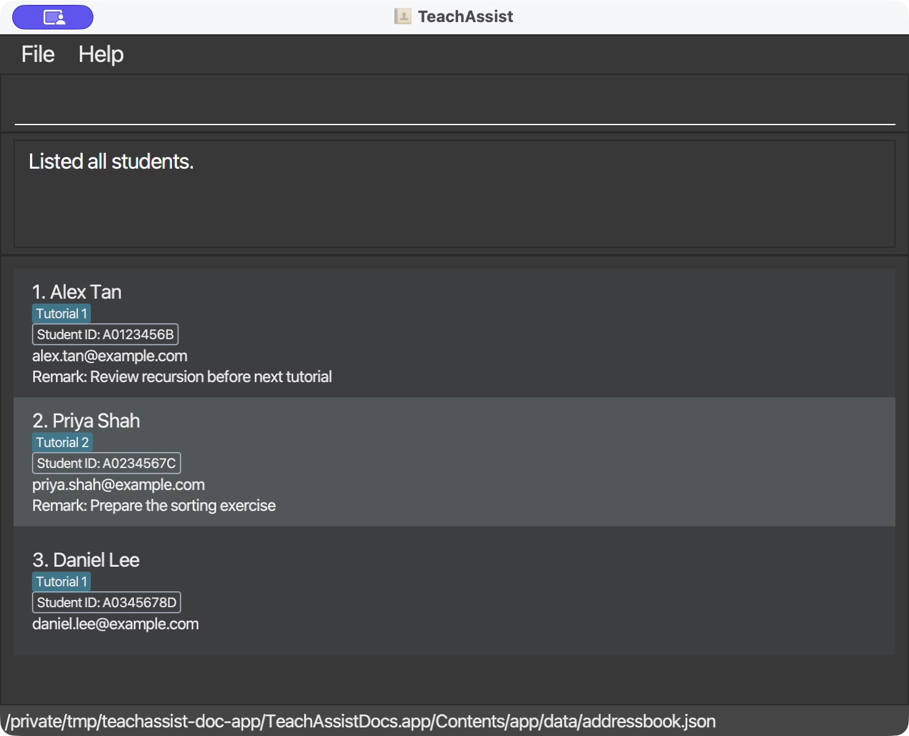

# TeachAssist User Guide

TeachAssist is a **desktop application for managing student records, optimized for use through a Command Line Interface (CLI)** while retaining the benefits of a Graphical User Interface (GUI). If you type quickly, TeachAssist can help you manage student information faster than traditional GUI applications.

<!-- * Table of Contents -->
<page-nav-print />

--------------------------------------------------------------------------------------------------------------------

## Quick start

1. Ensure that Java `25` or later is installed on your computer.<br>
   **Mac users:** Ensure you have the precise JDK version prescribed [here](https://se-education.org/guides/tutorials/javaInstallationMac.html).

1. Download the latest `.jar` file from [the TeachAssist releases page](https://github.com/AY2627S1-CS2103T-F12-1/tp/releases).

1. Copy the file to the folder you want to use as the _home folder_ for TeachAssist.

1. Open a terminal, `cd` to the folder containing the JAR file, and run `java -jar teach-assist-v1.4.jar`.<br>
   A GUI similar to the one below should appear in a few seconds. With no saved data file, the student list starts empty.<br>
   

1. Type a command in the command box and press Enter to execute it. For example, type **`help`** and press Enter to open the help window.<br>
   Some example commands you can try:

   * `list` : Lists all students.

   * `add n/John Doe i/A0123456B e/johnd@example.com r/Needs help with recursion` : Adds a student named `John Doe`.

   * `delete i/A0123456B` : Deletes the student whose Student ID is `A0123456B`.

   * `clear` : Deletes all students.

   * `exit` : Exits the app.

1. Refer to the [Features](#features) section below for details of each command.

TeachAssist fits its startup window within the available screen area, accounting for display scaling and the taskbar.
If a previously used monitor is disconnected, the saved window position is adjusted to fit the primary screen.
You can resize the window down to 450 × 400 logical pixels. At higher scaling, fewer student cards fit at once;
scroll the student list to reach the remaining students.

**Disclaimer:** Do not run multiple instances of TeachAssist. Running multiple instances of TeachAssist will lead to each instance overriding the same savefile which can lead to unintended behaviour.

--------------------------------------------------------------------------------------------------------------------

## Features

<box type="info" seamless>

**Notes about the command format:**<br>

* Words in `UPPER_CASE` are the parameters to be supplied by the user.<br>
  For example, in `add n/NAME`, replace `NAME` with a value such as `John Doe`.

* Items in square brackets are optional.<br>
  For example, `n/NAME [l/LABEL_NAME]` can be used as `n/John Doe l/Tutorial` or as `n/John Doe`.

* Parameters can be in any order.<br>
  For example, `add e/john@example.com i/A0123456B n/John Doe` is also acceptable.

* Commands that take no parameters, such as `help`, `exit`, and `clear`, reject non-whitespace trailing input.<br>
  For example, `help 123` reports an invalid command format error.

* If you are using a PDF version of this document, be careful when copying and pasting commands that span multiple lines as space characters surrounding line-breaks may be omitted when copied over to the application.
</box>

### Viewing help: `help`

Shows the Help window with the address of [TeachAssist’s User Guide](https://ay2627s1-cs2103t-f12-1.github.io/tp/UserGuide.html).
Click **Copy URL** to copy this address, then paste it into your browser to open the guide.

Format: `help`

The command accepts no arguments. Additional input, such as `help 123`, reports `Invalid command format!` followed by
the help usage text.

### Adding a student: `add`

Adds a student to TeachAssist with identifying information and optional free-text remarks.
Use remarks for observations such as test results, weak topics, and consultation timings.

Format: `add n/NAME i/STUDENT_ID e/EMAIL [r/REMARK] [l/LABEL_NAME]`

#### Parameter rules

* `n/`, `i/`, and `e/` are compulsory and cannot be empty. Each can appear only once.
* Parameters can appear in any order, including `r/` and `l/`. Prefixes are lowercase and case-sensitive.
* Enter one command line. Leading and trailing whitespace around the command and each value is ignored.
* A supported prefix at the start of a whitespace-separated token starts a parameter. Spaces can separate parameters.
* Unknown alphabetic prefix tokens, such as `x/` or `p/`, are rejected, including inside remarks.
* A prefix joined to other text does not start a parameter. For example, `https://example.com/n/Alex` remains remark text.

| Field | Accepted values and storage |
|-------|-----------------------------|
| Name | 1–100 Unicode code points after normalisation, with at least one letter. Allows Unicode letters, combining marks, spaces, apostrophes (`'` and `’`), hyphens, and periods. Digits and other symbols are rejected. Repeated internal spaces become one space; capitalisation is preserved. |
| Student ID | Exactly nine ASCII letters or digits, without internal spaces or punctuation. Stored in uppercase; `a0123456b` and `A0123456B` identify the same student. |
| Email | At most 254 characters with exactly one `@`. The local part has 1–64 ASCII letters, digits, periods, underscores, plus signs, or hyphens. It cannot start/end with a period or contain consecutive periods. The domain has at least two dot-separated labels of 1–63 ASCII letters, digits, or hyphens, without boundary hyphens. The final label has 2–63 letters. Only the domain is lowercased. Spaces are rejected, and mailbox existence is not checked. |
| Remark | Optional, at most 4,000 Unicode code points after trimming. Internal spacing and capitalisation are preserved. Omitting `r/` or supplying an empty `r/` stores an empty remark. At most one `r/` is allowed. Dates, grades, and the meaning of the text are not validated. Long remarks wrap on the student card. |
| Label | Optional. Contains 1–60 Unicode code points, including at least one letter or digit. Allows letters, combining marks, digits, spaces, hyphens, underscores, apostrophes, parentheses, and periods. Surrounding whitespace is trimmed; internal spacing and capitalisation are preserved. At most one `l/` is allowed. Omitting `l/` stores no label. |

Student cards wrap long names and email addresses onto multiple lines so you can read the complete values.
Resizing the window adjusts the wrapping; use the student list's vertical scrollbar to read taller cards.
Wrapping only changes the display and does not add spaces or line breaks to stored values.

Unlike numeric text such as `8/10`, a recognised prefix after `r/` starts another parameter.
For example, `r/Quiz: 8/10 l/Tutorial` stores `Quiz: 8/10` as the remark and `Tutorial` as a label.

Examples:

* `add n/Samuel i/A0456832Y e/samuel123@example.com r/Consultation time: 3rd Oct 12pm at Science`
* `add n/James Ho i/A0123456B e/jamesho@example.com l/Discrete Math Tutorial r/Needs help with recursion`
* `add n/Jamie Lim i/A0234567C e/jamie@example.com r/Struggles with recursion. Quiz 1: 8/10.`
* `add r/Needs help with recursion e/Alex@EXAMPLE.COM i/a0123456b n/Alex Tan`

#### Successful add

After saving succeeds, the student appears in the complete student list. The result shows the normalised Student ID,
name, optional remark, and total number of students. For example, when this creates the eighth student:

```text
Added student A0123456B: Alex Tan. Remark: Needs help with recursion
8 students listed.
```

When the remark is empty, the `Remark:` part is omitted. Empty remarks are also hidden on student cards.
Names do not determine duplicates: different students can share a name.
If the normalised Student ID already exists, the entire command is rejected; existing details and remarks are not merged.

#### Errors

The rows below follow the order in which errors are checked. If a command has multiple errors, only the first
applicable message is shown. Prefixes and Student IDs in messages reflect the supplied command.

| Problem | Message |
|---------|---------|
| Command spans multiple lines | `Invalid command format!`<br>`help: Shows program usage instructions.`<br>`Example: help` |
| Incorrect command word or capitalisation, e.g., `Add` | `Unknown command.` |
| Unknown parameter, e.g., `p/123` | `Unknown parameter: p/.` |
| Text before the first parameter | `Invalid command format. Usage: add n/NAME i/STUDENT_ID e/EMAIL [r/REMARK] [l/LABEL_NAME]` |
| Repeated parameter, e.g., two `n/` values | `Parameter n/ must be specified only once.` |
| Missing compulsory parameter | `Missing required parameter: i/.` |
| Empty compulsory parameter | `Parameter n/ cannot be empty.` |
| Empty label | `Parameter l/ cannot be empty.` |
| Invalid name | `Name must contain 1-100 characters, include a letter, and use only letters, spaces, apostrophes, hyphens, or periods.` |
| Invalid Student ID | `Student ID must contain exactly 9 letters or digits, with no spaces.` |
| Invalid email | `Email must have the form name@example.com and meet the supported email format.` |
| Invalid label | `Label names should be 1 to 60 characters long, contain at least one letter or digit, and only contain letters, digits, spaces, hyphens, underscores, apostrophes, parentheses, and periods.` |
| Oversized remark | `Remark must not exceed 4000 characters.` |
| Student data failed to load at startup | `Student data is unavailable because loading failed. Fix the data file and restart.` |
| Duplicate Student ID | `Student ID A0123456B already exists.` |
| Data storage location cannot be created | `Unable to create data storage location.` |
| Saving fails | `Unable to save student data.` |

For example, `add n/ i/123 e/bad p/123` reports `Unknown parameter: p/.` before checking the empty name,
invalid Student ID, or invalid email. When multiple parameters are repeated or missing, they are checked in
`n/`, `i/`, `e/`, `r/`, `l/` order where applicable. Field values are validated in name, Student ID, email,
label, then remark order. A multiline command is rejected by the general command parser before the add parser
can display add-specific usage. The startup-loading check occurs after parsing; duplicate and saving checks
occur only after a valid command passes that check.
Failed commands do not change existing student records or the saved file.

### Listing all students: `list`

Displays every student stored in TeachAssist. If the displayed list was previously restricted by `find`, this command restores the complete student list.

Format: `list`

Example:

```text
list
```

If at least one student exists, the expected successful output is:

```text
Listed all students.
```

If loading succeeded and there are no stored students, the displayed list remains empty and the command reports:

```text
No students found.
```

The command does not add, edit, delete, reorder, or save student records. Students remain in the existing master-list
order.

The `list` command does not accept additional arguments. Leading and trailing whitespace is ignored, but command words
are case-sensitive.

| Problem | Example | Message |
|---------|---------|---------|
| Additional argument | `list 3` | `Invalid command format!` followed by `Usage: list` on the next line |
| Parameter-like argument | `list n/Samuel` or `list n/` | `Invalid command format!` followed by `Usage: list` on the next line |
| Misspelled command | `lisst` | `Unknown command.` |
| Incorrect capitalisation | `List` or `LIST` | `Unknown command.` |
| Student data failed to load | `list` | `Student data is unavailable because loading failed. Fix the data file and restart.` |

### Editing a student: `edit`

Edits a student identified by Student ID, including a student hidden by the current filter.

Format: `edit i/STUDENT_ID [n/NAME] [e/EMAIL] [r/REMARK] [l/LABEL_NAME]... [dl/LABEL_NAME]...`

* `i/STUDENT_ID` is required and must identify an existing student. Matching is case-insensitive.
* `i/`, `n/`, `e/`, and `r/` may each appear at most once. Unknown alphabetic prefixes are rejected, including inside remarks.
* At least one field to change must be provided. Student ID itself cannot be edited.
* `n/` and `e/` replace the existing name and email. Their values cannot be empty and follow the rules under `add`.
* `r/` replaces the existing remark. An empty `r/` clears it.
* Each `l/LABEL_NAME` adds a label; each `dl/LABEL_NAME` removes one. Both may be repeated, and label matching is case-insensitive. Label names follow the `l/LABEL_NAME` rules in the Add section.
* The same label cannot appear twice under `l/` or twice under `dl/`, ignoring case. An empty `dl/` is invalid.
* All removals happen before additions, regardless of parameter order. You can remove and add the same label to change
  its capitalisation, for example `edit i/A0123456B dl/tutorial 1 l/Tutorial 1`.
* An empty `l/` clears **all** labels. It cannot be combined with another `l/` or any `dl/` in the same command.
* Fields not supplied keep their existing values. A successful edit displays the complete student list.
* Attendance records are preserved, including records for labels that are removed.

Examples:

* `edit i/A0123456B e/johndoe@example.com` changes that student's email address.
* `edit i/A0123456B l/Tutorial 1` adds a group label.
* `edit i/A0123456B dl/Tutorial 1 l/Tutorial 2` replaces one group label while keeping the others.
* `edit i/A0123456B l/ r/` removes every label and clears the remark.

If a `dl/` label is absent, an `l/` label still exists after removals, or an empty `l/` is combined with another label
change, the entire edit is rejected. No partial field or label changes are applied.

#### Successful edit

For a student named John Doe with label `Tutorial 1`, running `edit i/A0123456B e/johndoe@example.com` reports:

```text
Edited student: John Doe; Student ID: A0123456B; Email: johndoe@example.com; Labels: [Tutorial 1]
```

The feedback lists the updated name, Student ID, email, and labels, followed by `; Remark: REMARK` when the student has
a remark. For example, `edit i/A0123456B r/Needs help with recursion` reports
`...; Labels: [Tutorial 1]; Remark: Needs help with recursion`. Multiple labels may be displayed in any order.

#### Errors

| Problem | Message |
|---------|---------|
| Unknown parameter | `Unknown parameter: x/.` |
| Text before the first parameter | `Invalid command format!` followed by the edit usage |
| Repeated single-value parameter, e.g., two `n/` values | `Multiple values specified for the following single-valued field(s): n/` |
| Missing Student ID | `Missing required parameter: i/.` |
| Empty Student ID | `Parameter i/ cannot be empty.` |
| Invalid Student ID, name, email, remark, or label | The corresponding field constraint message under `add`; empty `n/` and `e/` also produce these messages |
| No field to change, e.g., `edit i/A0123456B` | `At least one field to edit must be provided.` |
| Empty label removal | `Parameter dl/ cannot be empty.` |
| Same label repeated under one prefix | `Parameter l/ repeats label "Tutorial 1".` (or `dl/`, using the repeated value's spelling) |
| Empty `l/` combined with another label change | `An empty l/ cannot be combined with other label changes.` |
| Student does not exist | `Student with ID A0123456B is not in the records.` |
| Removing a label the student does not have | `Student A0123456B does not have label "Tutorial 1".` |
| Adding a label still present after removals | `Student A0123456B already has label "Tutorial 1".` |
| Student data failed to load at startup | `Student data is unavailable because loading failed. Fix the data file and restart.` |
| Data storage location cannot be created | `Unable to create data storage location.` |
| Saving fails | `Unable to save student data.` |

This table lists possible errors, not their checking order. Only the first detected error is reported. When several
single-value parameters repeat, the message lists their prefixes; their displayed order is not guaranteed.
As with other commands, use one line and lowercase command words and prefixes. A failed edit preserves the records,
current view, undo history, and saved file. Changes become visible only after saving succeeds.

### Finding students by name, student ID, email, remark, or label: `find`

Shows students matching a name, student ID, email, remark, or complete group-label name.

Format: `find n/KEYWORD [MORE_KEYWORDS]` or `find i/KEYWORD [MORE_KEYWORDS]`
or `find e/KEYWORD [MORE_KEYWORDS]` or `find r/KEYWORD [MORE_KEYWORDS]` or `find l/LABEL_NAME`

* Supply exactly one non-empty prefix: `n/`, `i/`, `e/`, `r/`, or `l/`. Repeated prefixes and mixed search fields are rejected.
* All searches are case-insensitive and search the complete stored student list, replacing the previous search results.
* Name, ID, email, and remark searches match any supplied keyword, including partial matches anywhere in the selected field.
* Label searches match the **complete label name**. For example, `find l/Tutorial` does not match `Tutorial 1`.
  A multi-word label is one value, not separate keywords. A student with multiple labels appears if any label matches.
  Unicode label matching follows the same case rules as editing and loading labels: `I` matches `i`,
  while the dotless `ı` is a different label.
* Label names follow the rules under `add`: 1–60 Unicode code points, at least one letter or digit, and only the
  permitted characters. Surrounding whitespace is ignored; internal spacing is preserved. Slashes and control
  characters are rejected.
* Reports `N students listed.`, or `1 student listed.` for one match. If loading succeeded but no students match,
  the displayed list is cleared and reports `0 students listed.`
* Student records and the saved data file are unchanged. Use `list` to show all students again.

Examples:

* `find i/a03 a02` matches student IDs containing either `a03` or `a02`.
* `find n/John` matches `john` and `John Doe`.
* `find e/example.com` matches students whose email contains `example.com`.
* `find r/recursion loops` matches remarks containing either `recursion` or `loops`.
* `find r/curs` matches a remark such as `Needs help with recursion`.
* `find r/8/10` matches a remark such as `Quiz 1: 8/10`.
* `find n/tri sam` matches `tristan` and `samuel`.<br>
  
* `find l/Discrete Math Tutorial` matches that complete label, including different capitalisation.

The former `filter` command has been replaced by `find l/LABEL_NAME`.

#### Errors

| Problem | Message |
|---------|---------|
| Extra words before the search parameter | `Invalid command format!` followed by the correct `find` format |
| Unknown search parameter | `Unknown parameter: p/.` |
| Repeated same search parameter | `Parameter n/ must be specified only once.` (or the repeated prefix, such as `l/`) |
| Missing search parameter | `Missing required parameter: n/, i/, e/, r/, or l/.` |
| More than one search parameter type | `Parameter n/, i/, e/, r/, or l/ must be specified only once.` |
| Repeated remark parameter, e.g., `find r/recursion r/loops` | `Parameter r/ must be specified only once.` |
| Empty remark parameter, e.g., `find r/` | `Parameter r/ cannot be empty.` |
| Empty search parameter | `Parameter l/ cannot be empty.` (or the supplied prefix) |
| Invalid label | `Label names should be 1 to 60 characters long, contain at least one letter or digit, and only contain letters, digits, spaces, hyphens, underscores, apostrophes, parentheses, and periods.` |
| Using the removed command, such as `filter l/Tutorial 1` | `Unknown command.` |
| Student data failed to load | `Student data is unavailable because loading failed. Fix the data file and restart.` |

Errors are checked in the order of words before the first prefix, unknown prefixes, repeated prefixes, missing
prefixes, mixed search fields, empty values, then label validation. For a valid search, data availability is checked
before searching. Failed commands preserve the displayed list, student records, and saved file.

### Deleting a student: `delete`

Deletes the student with the specified Student ID, including their name, email, remark, labels, and attendance records.

Format: `delete i/STUDENT_ID`

* Exactly one non-empty `i/` parameter is required. No other parameter prefixes are accepted.
* Student IDs follow the same nine-character ASCII alphanumeric rules as `add`.
* Matching is case-insensitive: `delete i/a0123456b` and `delete i/A0123456B` identify the same student.
* The student is located in the complete record list, even when hidden by a `find` filter.
* The current filter is preserved after deletion. If the student was hidden, the visible list can stay unchanged.
* Leading/trailing whitespace is ignored, and a space can separate `delete` from `i/`. Prefixes remain lowercase.
* The command must occupy one line. Numeric index commands such as `delete 1` are no longer accepted.
* Deletion becomes visible only after saving succeeds. A save failure retains the entire record and previous data file.

Examples:

* `delete i/A0123456B` deletes the student with that ID.
* After `find n/Betsy`, `delete i/A0123456B` still deletes that ID, whether or not the student appears in the results.

Successful output, when the student is Alex Yeoh:

```text
Deleted student A0123456B: Alex Yeoh.
```

The rows below follow error-checking order. If several errors are present, only the first applicable message
is shown. Prefixes and Student IDs in messages reflect the supplied command.

| Problem | Message |
|---------|---------|
| Command spans multiple lines | `Invalid command format!`<br>`help: Shows program usage instructions.`<br>`Example: help` |
| Incorrect command word or capitalisation, e.g., `Delete` | `Unknown command.` |
| Unknown parameter, e.g., `x/123` | `Unknown parameter: x/.` |
| Text before the `i/` parameter | `Invalid command format. Usage: delete i/STUDENT_ID` |
| Repeated Student ID | `Parameter i/ must be specified only once.` |
| Missing Student ID | `Missing required parameter: i/.` |
| Empty Student ID | `Parameter i/ cannot be empty.` |
| Invalid Student ID | `Student ID must contain exactly 9 letters or digits, with no spaces.` |
| Student data failed to load at startup | `Student data is unavailable because loading failed. Fix the data file and restart.` |
| Student does not exist | `Student with ID A0123456B is not in the records.` |
| Data storage location cannot be created | `Unable to create data storage location.` |
| Saving fails | `Unable to save student data.` |

For example, `delete i/123 x/1` reports `Unknown parameter: x/.` before checking the invalid Student ID.
The startup-loading check occurs after parsing. Finding the student and saving happen only after a valid command
passes that check. Failed commands leave records, the current filter, and the saved file unchanged.

### Recording attendance: `mark`

Records that a student attended a group on a particular date.

Format: `mark i/STUDENT_ID d/YYYY-MM-DD l/GROUP`

* Exactly one non-empty `i/`, `d/`, and `l/` is required, in any order. Prefixes are lowercase and case-sensitive.
* Student IDs and group names follow the rules under `add`. Matching ignores case, but internal group spacing matters.
* The date must be a valid calendar date in `YYYY-MM-DD` format, including zero-padded months and days.
* The student must exist and currently have the specified group label.
* Attendance is identified by date and group. Marking the same date and group again is rejected.
* The student can be hidden by the current filter. The command preserves that filter and all other student details.

Example, for a student with the `Tutorial 1` label:

```text
mark i/A0123456B d/2026-10-20 l/tutorial 1
```

Successful output uses the stored group label's capitalisation:

```text
Marked student A0123456B present for Tutorial 1 on 2026-10-20.
```

| Problem | Message |
|---------|---------|
| Student does not exist | `Student with ID A0123456B is not in the records.` |
| Student does not have the group label | `Student A0123456B does not have group label "Tutorial 1".` |
| Attendance already exists | `Student A0123456B is already marked present for Tutorial 1 on 2026-10-20.` |

For input and saving errors shared with `unmark`, see [Attendance command errors](#attendance-command-errors).

### Removing attendance: `unmark`

Removes one previously recorded attendance entry for a student, date, and group.

Format: `unmark i/STUDENT_ID d/YYYY-MM-DD l/GROUP`

* The parameter rules are the same as for `mark`: exactly one non-empty `i/`, `d/`, and `l/`, in any order.
* Student ID and group matching ignore case. The date must match exactly.
* The student and attendance entry must exist. Repeating a successful `unmark` reports that attendance is not marked.
* Attendance can be removed even if the student no longer has that group label.
* Other attendance entries, student details, group labels, and the current filter are preserved.
* The student can be hidden by the current filter. The removal is saved before it is applied to the live records.

Example, to remove the attendance recorded above:

```text
unmark i/a0123456b d/2026-10-20 l/tutorial 1
```

Successful output uses the attendance entry's stored group spelling:

```text
Unmarked student A0123456B for Tutorial 1 on 2026-10-20.
```

| Problem | Message |
|---------|---------|
| Student does not exist | `Student with ID A0123456B is not in the records.` |
| No attendance entry for the date and group | `Student A0123456B is not marked present for Tutorial 1 on 2026-10-20.` |

#### Attendance command errors

Both commands must occupy one line. Input is checked for unknown prefixes, text before the first parameter,
repeated parameters, then missing or empty parameters. Repeated and missing/empty checks follow `i/`, `d/`, `l/`
order. Field values are then validated in Student ID, date, and group order. Only the first error is reported.

| Problem | Example message |
|---------|-----------------|
| Command spans multiple lines | `Invalid command format!` followed by the `help` usage |
| Incorrect command word or capitalisation, e.g., `Unmark` | `Unknown command.` |
| Unknown parameter | `Unknown parameter: x/.` |
| Text before the first parameter | `Invalid command format. Usage: unmark i/STUDENT_ID d/YYYY-MM-DD l/GROUP` (or the corresponding `mark` usage) |
| Repeated parameter | `Parameter d/ must be specified only once.` |
| Missing parameter | `Missing required parameter: d/.` |
| Empty parameter | `Parameter l/ cannot be empty.` |
| Invalid Student ID | `Student ID must contain exactly 9 letters or digits, with no spaces.` |
| Invalid date, e.g., `2026-02-30` or `2026-2-03` | `Date must use a valid YYYY-MM-DD date.` |
| Invalid group name | See the label constraints under [Adding a student](#adding-a-student-add). |
| Student data failed to load at startup | `Student data is unavailable because loading failed. Fix the data file and restart.` |
| Data storage location cannot be created | `Unable to create data storage location.` |
| Saving fails | `Unable to save student data.` |

The startup-loading check occurs after parsing. Student and attendance checks follow it, and saving occurs last.
Failed commands preserve the records, active filter, and saved file.

### Viewing attendance: `attendance`

Shows which members of a tutorial group were present on a date.

Format: `attendance d/YYYY-MM-DD l/GROUP`

* Exactly one non-empty `d/` and `l/` is required, in any order. They follow the same rules as in
  [`mark`](#recording-attendance-mark).
* The view lists every student who **currently** has the group label, in the same order as the student list,
  including students hidden by `find`.
* Each student is shown as **Present** if they were marked for that date and group, and **Absent** otherwise.
  There is no separate way to record an absence.
* The totals of present and absent students are shown above the list and in the result message.
* Group membership is based on current labels. A student marked present who has since lost the label is not shown,
  but their attendance record is kept.
* If no student has the group label, an empty view with zero totals is shown.
* This command does not change any data.

The attendance view replaces the student list:

* A successful `mark` or `unmark` refreshes it immediately, so you can mark students one by one and watch the totals
  change.
* A failed command leaves it open and unchanged.
* Any other successful command, such as `list` or `undo`, returns to the student list.

The narrowest supported window width is **450 logical pixels**. Long student names wrap in the attendance list, so the
Present/Absent badge remains visible at that width.

Examples:

* `attendance d/2026-10-20 l/Tutorial 1`
* `attendance l/tutorial 1 d/2026-10-20` shows the same view.

Successful output, when one of three group members was marked:

```text
Attendance for Tutorial 1 on 2026-10-20: 1 present, 2 absent.
```

The group name in the message is shown as typed.
Input errors use the same messages and order as [Attendance command errors](#attendance-command-errors), without the
Student ID, with the usage line `Invalid command format. Usage: attendance d/YYYY-MM-DD l/GROUP`.
An `i/` parameter is rejected as `Unknown parameter: i/.`
Because `attendance` only reads data, it remains available when student data fails to load.

### Clearing all entries: `clear`

Clears all student records from TeachAssist, including their remarks, labels, and attendance. This affects the
complete stored list, even if `find` currently shows only some students or an attendance view is open.

Format: `clear`

The command takes effect without a confirmation prompt. After saving succeeds, the student list is empty and the
result is:

```text
Address book has been cleared!
```

Running `clear` on an empty list also succeeds with this message. The command accepts no arguments; additional input,
such as `clear 1`, reports `Invalid command format!` followed by `Usage: clear`. The current search predicate is
retained, although the list is empty.

Run `undo` immediately afterward to restore the cleared records and display all students. This recovery is available
only while the snapshot remains in the current session's undo history; restarting discards that history.

| Problem | Message |
|---------|---------|
| Student data failed to load at startup | `Student data is unavailable because loading failed. Fix the data file and restart.` |
| Data storage location cannot be created | `Unable to create data storage location.` |
| Saving fails | `Unable to save student data.` |

A failed clear leaves the records, current view, undo history, and saved file unchanged.

### Undoing the latest data change: `undo`

Restores the student records to the state before the latest successfully saved data-changing command.

Format: `undo`

Successful output:

```text
Undid last change.
```

* TeachAssist retains at most 100 earlier student-data snapshots for the current session. The snapshots contain the
  complete student records, including remarks, labels, and attendance.
* A successful undo is destructive: it discards the state being reversed. There is no redo command or forward history.
  A later successful data change records the then-current state as a new predecessor.
* Restoring a snapshot resets the displayed list to all students. It does not restore a previous `find` result, window
  settings, or other GUI state.
* The restored student data is saved before it replaces the live records. If saving fails, the records, displayed list,
  saved file, and undo history remain unchanged.
* Undo history is in memory only and is cleared when TeachAssist restarts.
* Leading and trailing whitespace is ignored. The command word is case-sensitive and it accepts no arguments.
* If there is nothing to undo, records and the current student filter stay unchanged; an open attendance view closes.

| Situation | Exact message |
|-----------|---------------|
| No earlier state is available | `Nothing to undo.` |
| Additional or parameter-like input, e.g. `undo 1` or `undo n/Samuel` | `Invalid command format!` followed by `Usage: undo` |
| Incorrect capitalization, e.g. `Undo` | `Unknown command.` |
| Student data failed to load at startup | `Student data is unavailable because loading failed. Fix the data file and restart.` |
| Data storage location cannot be created | `Unable to create data storage location.` |
| Saving the restored state fails | `Unable to save student data.` |

### Exiting the program: `exit`

Exits the program.

Format: `exit`

The command accepts no arguments. Additional input, such as `exit extra`, reports `Invalid command format!` followed by
`Usage: exit`.

### Loading the data

When TeachAssist starts, it loads student data from `[JAR file location]/data/addressbook.json` and shows the outcome
in the result display.

The rows below follow the order in which loading is checked. Records are checked in the order they appear in the file,
and only the first problem found is shown.

| Situation | Message |
|-----------|---------|
| No data file exists yet | `No existing student data found. Starting with an empty student list.` |
| The data file cannot be read, e.g., file permissions deny access | `Unable to load student data.` |
| The data file is not valid JSON, or a record has a missing or invalid value | `Unable to load student data. The data file may be corrupted or invalid.` |
| Two records share a Student ID, ignoring case | `Unable to load student data: duplicate Student ID A0123456B detected.` |
| Loading succeeds | `3 students loaded.` (or `1 student loaded.`) |

If loading fails, TeachAssist starts with an empty student list and leaves the data file untouched:

* Commands that change student records (`add`, `edit`, `delete`, `mark`, `unmark`, `clear`, and `undo`), as well as
  `list` and `find`, are blocked with
  `Student data is unavailable because loading failed. Fix the data file and restart.`
* `attendance`, `help`, and `exit` remain available.

To recover, close TeachAssist, fix or restore the data file, and restart. Deleting the data file makes TeachAssist start
with an empty student list.

### Saving the data

TeachAssist automatically saves after commands that change student records (`add`, `edit`, `delete`, `mark`, `unmark`,
`clear`, and successful `undo`).
You do not need to save manually. Commands such as `find`, `list`, `attendance`, `help`, and `exit` do not write
student data.
If saving fails, the proposed change is not applied, and existing records, the displayed filter, and the previous
saved file remain unchanged. The application displays `Unable to save student data.`
Storage must support atomic file replacement; unsupported storage produces the same save error.
If the `data` folder does not exist and cannot be created, e.g., because a file named `data` is in its place or the
JAR file location is read-only, the application displays `Unable to create data storage location.` instead.

### Editing the data file

TeachAssist data is saved automatically as a JSON file `[JAR file location]/data/addressbook.json`. Advanced users are welcome to update data directly by editing that data file.

The application also keeps `preferences.json` and `addressbook.log.*` files in the JAR’s folder, even when you launch it
from another directory. Use a folder where you have write permission. Existing files in the launch directory are not
imported automatically; to reuse old records, close TeachAssist and copy the existing `data` folder beside the JAR.

<box type="warning" seamless>

**Caution:**
If your changes make the data file invalid, TeachAssist starts with an empty student list and preserves the invalid file.
See [Loading the data](#loading-the-data) for the message shown and the commands that remain available.
Back up the file before editing it.<br>
Furthermore, certain edits can cause TeachAssist to behave in unexpected ways (e.g., if a value entered is outside of the acceptable range). Therefore, edit the data file only if you are confident that you can update it correctly.

Each student record must include a valid `studentId`. Older data files that do not include `studentId` for every student may fail to load until the missing values are added manually.
Group labels are saved under each student record as `labels`. Older data files without `labels` still load; those students simply start with no labels.
Legacy `tags` fields are ignored when loading and are not saved again.
Attendance is saved under each person record as `attendance`, a list of `{"date": "2026-10-20", "group": "Tutorial 1"}`
entries. Each date and group pair may appear only once per person, ignoring the case of the group. Older data files
without `attendance` still load; those persons simply start with no attendance records.
</box>

--------------------------------------------------------------------------------------------------------------------

## FAQ

**Q**: How do I transfer my data to another computer?<br>
**A**: Install the app on the other computer and overwrite the data file it creates with the data file from your previous TeachAssist home folder.

--------------------------------------------------------------------------------------------------------------------

## Known issues

1. **If you minimize the Help Window** and then run the `help` command (or use the `Help` menu, or the keyboard shortcut `F1`) again, the original Help Window will remain minimized, and no new Help Window will appear. The remedy is to manually restore the minimized Help Window.

--------------------------------------------------------------------------------------------------------------------

## Command summary

Action     | Format, Examples
-----------|----------------------------------------------------------------------------------------------------------------------------------------------------------------------
**Add**    | `add n/NAME i/STUDENT_ID e/EMAIL [r/REMARK] [l/LABEL_NAME]` <br> e.g., `add n/James Ho i/A0123456B e/jamesho@example.com r/Needs help with recursion l/Discrete Math Tutorial`
**Attendance** | `attendance d/YYYY-MM-DD l/GROUP`<br> e.g., `attendance d/2026-10-20 l/Tutorial 1`
**Clear**  | `clear`
**Delete** | `delete i/STUDENT_ID`<br> e.g., `delete i/A0123456B`
**Edit**   | `edit i/STUDENT_ID [n/NAME] [e/EMAIL] [r/REMARK] [l/LABEL_NAME]... [dl/LABEL_NAME]...`<br> e.g., `edit i/A0123456B dl/Tutorial 1 l/Tutorial 2`
**Find**   | `find n/KEYWORD [MORE_KEYWORDS]` or `find i/KEYWORD [MORE_KEYWORDS]` or `find e/KEYWORD [MORE_KEYWORDS]` or `find r/KEYWORD [MORE_KEYWORDS]` or `find l/LABEL_NAME`<br> e.g., `find n/James Jake`
**List**   | `list`
**Mark**   | `mark i/STUDENT_ID d/YYYY-MM-DD l/GROUP`<br> e.g., `mark i/A0123456B d/2026-10-20 l/Tutorial 1`
**Unmark** | `unmark i/STUDENT_ID d/YYYY-MM-DD l/GROUP`<br> e.g., `unmark i/A0123456B d/2026-10-20 l/Tutorial 1`
**Undo**   | `undo`
**Help**   | `help`
**Exit**   | `exit`
